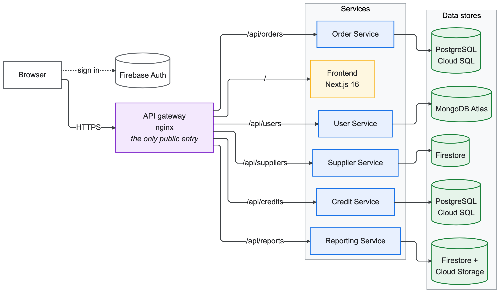
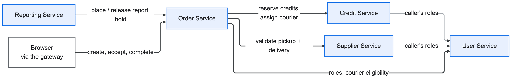
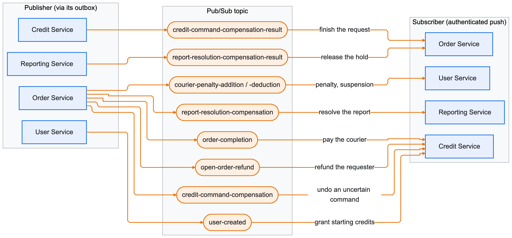

<!--
AI Assistance Disclosure:
Tool: OpenAI Codex (GPT-5), date: 2026-10-13
Mode: Documentation.
Scope: Updated repository documentation for the Reporting Service, attachment storage, routing, and ownership.
Author review: I reviewed for correctness.
-->

<!--
AI Assistance Disclosure:
Tool: OpenAI Codex (GPT-5), date: 2026-09-25
Mode: Documentation refactoring and disclosure assistance.
Scope: Assisted with documentation cleanup and Credit Service disclosure content.
Author review: I validated correctness and edited for style.
-->

# CS3219 — Software Design and Architecture (AY2627 Sem 1)

## Friend on Campus (FoC)

**Friend on Campus (FoC)** is a peer-to-peer campus errand platform where
students can request items to be collected from stores or facilities on
campus, and other students can fulfil (and deliver) those requests. The
platform runs on a closed credit economy — credits cannot be bought,
withdrawn, or exchanged for money, and only circulate within the platform.

---

## Team Members

| Name | Role |
| ----- | ----- |
| Khoo Yu Yien | Credit Service (balances, reservations, transaction history, admin credit endpoints, sign-up credits, Credit side of compensation); Reporting Service (NTH3: reports and attachments) |
| Tham Yao Xiang | Order Service (core order lifecycle, admin order APIs, penalty and report integration); administrator dashboard UI (NTH1) |
| Oh Yi Xian | User Service (profiles, Firebase sign-up, roles, user-created events, account deletion); penalty system (NTH2: penalties, courier suspension and its UI) |
| Zheng Jiongjie | Supplier Service (catalogue, search/filter API, supplier management UI); CI/CD pipeline & cloud deployment (NTH5: GitHub Actions, Cloud Run, Artifact Registry, Firestore, staging/production environments) |
| Choong Weng Sheng | Order Service (sprint 2–3 features, order UI, Order–Credit compensation and recovery); errand reposting (NTH4) |

### Nice-to-haves

| NTH | What it adds | Owner | Where |
| --- | --- | --- | --- |
| NTH1 Administrator dashboard | Admins see and act on all orders, users, suppliers and reports | Tham Yao Xiang | Order admin APIs; `frontend/src/app/admin` |
| NTH2 Penalty system | Couriers who abandon or overrun errands get penalties and are suspended from accepting at the threshold | Oh Yi Xian | User Service (Pub/Sub penalty consumer), Order (penalty policy in `foc-common`) |
| NTH3 Report system | Requesters and couriers report problems with an errand; admins resolve them | Khoo Yu Yien | `reporting-service/`, Order report holds |
| NTH4 Errand reposting | An expired errand comes back as a new linked order without retyping | Choong Weng Sheng | Order Service |
| NTH5 CI/CD and cloud deployment | Every merge is tested and deployed to a live staging environment | Zheng Jiongjie | `.github/workflows/`, `scripts/ci/`, `infra/`, [docs/ci-cd.md](docs/ci-cd.md) |

---

## Architecture

Components and the data each service owns:



How the services talk to each other. Synchronous HTTP calls, where the caller needs the answer now
(grey lines are role lookups):



Events and commands over Pub/Sub, where the result can follow. Each publisher stores them in an
outbox first, so an event survives a crash or a Pub/Sub outage:



The deployment diagrams (pipeline and cloud runtime) are in [docs/ci-cd.md](docs/ci-cd.md). An
errand end to end, the compensation flow and the order lifecycle are in
[docs/architecture.md](docs/architecture.md), with the key design decisions and how the system
scales. All diagrams and their sources are in [docs/diagrams/](docs/diagrams/README.md).

- **Microservices**: each backend service is an independent Spring Boot app with its own
  database, chosen per service (database-per-service): Firestore for the read-heavy supplier
  catalogue and reports, PostgreSQL on Cloud SQL for Order and Credit (transactions, row locks
  and constraints for order state and money), MongoDB Atlas for user profiles, and private Cloud
  Storage for report attachments. Services never read another service's data directly; they call
  its API or consume its events.
- **Network**: only the gateway is public. Every other Cloud Run service has internal ingress and
  is reached over a VPC (see [docs/ci-cd.md](docs/ci-cd.md)).
- **Frontend**: a single Next.js app that only renders UI and calls the services' APIs.
- **Gateway**: nginx serves the UI and routes `/api/<service>` to each service, so the
  browser talks to one origin.
- **Auth**: users sign in with Firebase Auth; every service validates the Firebase ID
  token (`Authorization: Bearer ...`) and enforces roles itself.

## Tech Stack

| Layer | Technology |
| --- | --- |
| Backend services | Java 21, Spring Boot 4.1.1 (Web MVC, Security OAuth2 Resource Server, Validation, Actuator), Maven wrapper |
| Data | Firestore (Supplier, Reporting), PostgreSQL on Cloud SQL with Flyway (Order, Credit), MongoDB Atlas (User), private Cloud Storage (report attachments); one database per service per environment |
| Messaging | Google Cloud Pub/Sub (cloud), Pub/Sub emulator (local) |
| Auth | Firebase Authentication (ID tokens verified by each service) |
| Frontend | Next.js 16 (App Router), TypeScript, Tailwind CSS 4, shadcn/ui |
| Gateway | nginx |
| Testing | JUnit 5, Spring Boot Test, Testcontainers (Firestore emulator, PostgreSQL, Pub/Sub emulator), JaCoCo (≥ 80% line + branch) |
| Containers | Docker, Docker Compose |
| CI/CD & cloud | GitHub Actions, Google Cloud Run, Artifact Registry, Workload Identity Federation |

---

## Repository Structure

This repository follows a **one-service-per-folder** structure: each
microservice lives in its own top-level folder.

```text
.
├── user-service/          # Spring Boot service (one per folder)
├── supplier-service/
├── order-service/
├── credit-service/
├── reporting-service/     # report records and private photo attachments (NTH3)
├── foc-common/            # shared Maven library: courier penalty policy (not a service)
├── admin-service/         # placeholder, not deployed; the admin dashboard uses the services' admin APIs
├── frontend/              # Next.js UI for every feature
├── gateway/               # nginx: routes /api/<service> and serves the UI
├── data/                  # seed data (CSV, images)
├── infra/
│   ├── environments/      # non-secret config per cloud environment
│   ├── firebase-emulator/ # local Firebase Auth, Firestore and Storage emulators
│   └── gcp/               # one-time GCP bootstrap (infrastructure as code)
├── scripts/ci/            # scripts used by the GitHub Actions workflows
├── docs/                  # architecture and design decisions, CI/CD runbook, demo runbook, diagrams, templates
├── .github/workflows/     # CI, staging and production pipelines
├── compose.yaml           # local deployment of the whole system
├── AGENTS.md              # conventions every service follows (humans and AI tools)
└── README.md
```

- Any **nice-to-have (N2H)** feature that warrants its own service should
  be added as an **additional folder** at the same level, following the
  same per-service structure.
- Files for agentic coding tools (e.g. agent configs, prompts, skills)
  may be added as needed, but must still **respect the
  one-service-per-folder skeleton** for core implementation.
- **Before adding or changing a service, read [AGENTS.md](AGENTS.md)**: it defines the
  folder layout, tech stack, runtime contract, API conventions and testing bar that every
  service follows.
- [foc-common](foc-common/README.md) is an ordinary Maven library, not a service or Git
  submodule; Order is its first consumer. Build Order with it from the repo root:
  `bash ./mvnw -pl order-service -am verify` (PowerShell: `.\mvnw.cmd -pl order-service -am verify`).
  Compose bundles it automatically; a direct Order image build uses
  `docker build -f order-service/Dockerfile .`. Other backends keep their standalone builds.

---

## Getting Started (local, containerised)

Prerequisites: Docker Desktop. For development outside containers: JDK 21 and Node 24.

```bash
cp .env.example .env        # optional: override ports / admin emails
docker compose up --build
```

No cloud credentials are needed. Locally, the Order Service publishes its events to a **Pub/Sub
emulator** (`pubsub-emulator`, topics and push subscriptions created by `pubsub-init`), which
pushes them to the Credit Service, so the whole asynchronous Order -> Credit flow runs offline.
The cloud environments use Google Cloud Pub/Sub.

| URL | What |
| --- | --- |
| http://localhost:8080 | The app (gateway: UI + all APIs) — use this one |
| http://localhost:4000 | Firebase emulator UI (test users, Firestore data) |
| http://localhost:3000 | Frontend directly |

Locally, sign-in uses the Firebase **Auth emulator**: create an account on the sign-in
page (or in the emulator UI). Emulator accounts are separate from the cloud ones and are
kept across restarts in the `firebase-data` volume. Services that run with mock roles give the
admin role to the accounts listed in `MOCK_ADMIN_EMAILS` (default
`admin@u.nus.edu,e1398851@u.nus.edu`).

The Supplier, Order and Credit services read roles from the User Service instead. Signing up on
the sign-in page creates the User Service profile. An admin can promote other accounts from the
admin pages (`PUT /api/users/{userId}/user-promotion`), so only the first admin needs granting by
hand, once, in the local MongoDB (or set `SUPPLIER_USER_SERVICE_MODE=mock` in `.env` for the Supplier
Service):

```bash
docker compose exec mongodb mongosh UserServiceDB --quiet   --eval 'db.users.updateOne({email: "admin@u.nus.edu"}, {$addToSet: {roles: "admin"}})'
```

Locally, creating a user with the app's user sign up function will create a user in a local 
MongoDB database, seperate from the MongoDB Atlas cloud. It is kept across restarts in the 
`firebase-data` volume. To view this account in the local MongoDB database, connect to
`mongodb://localhost:27017/?directConnection=true` on the MongoDB Compass app, 
or run `docker compose exec mongodb mongosh` while the app is running, 
then `use UserServiceDB` and `db.users.find()` in the mongosh terminal.

Signing up an account locally will require email verification, which can be emulated by
entering `docker compose logs firebase-emulator` upon account creation and copying the
verification link into a web browser while the app is running locally.

### Third-party images

The application services are built from our own Dockerfiles. Databases, messaging and base images
are pre-built images, used unmodified:

| Image | Source | Used for |
| --- | --- | --- |
| `eclipse-temurin:21-jdk`, `eclipse-temurin:21-jre` | [Docker Official Image](https://hub.docker.com/_/eclipse-temurin) (Eclipse Adoptium) | Build and runtime of the Spring Boot services |
| `node:24-alpine`, `node:24-slim` | [Docker Official Image](https://hub.docker.com/_/node) (Node.js) | Frontend build and runtime; base of the Firebase emulator image |
| `nginx:1.29-alpine` | [Docker Official Image](https://hub.docker.com/_/nginx) (NGINX) | Gateway |
| `mongo:8` | [Docker Official Image](https://hub.docker.com/_/mongo) (MongoDB) | User Service database (local) |
| `postgres:15-alpine` | [Docker Official Image](https://hub.docker.com/_/postgres) (PostgreSQL) | Order and Credit Service databases (local) |
| `gcr.io/google.com/cloudsdktool/google-cloud-cli:emulators` (pinned by digest in compose) | [Google Cloud CLI](https://cloud.google.com/sdk/docs/downloads-docker) | Pub/Sub emulator (local); Firestore emulator in integration tests (Testcontainers) |
| `python:3.12-alpine` | [Docker Official Image](https://hub.docker.com/_/python) (Python) | `pubsub-init`: creates the local Pub/Sub topics and subscriptions (`infra/pubsub-emulator-init.py`) |
| `firebase-tools@15.31.0` (npm) | [Firebase CLI](https://github.com/firebase/firebase-tools) | Firebase Auth, Firestore and Storage emulators (`infra/firebase-emulator`) |

---

## CI/CD and Environments

| Trigger | Workflow | Result |
| --- | --- | --- |
| Pull request / push to a branch | **CI** | Tests (+ coverage gate) and a Docker build for every changed service |
| Push to `main` | **Deploy staging** | CI, then images built once (tagged with the commit SHA) and rolled out to **staging** |
| Manual ("Run workflow") | **Deploy production** | Promotes the exact images staging verified to **production** |

Rollouts are health-checked on the new revision before it receives traffic; a failed
check leaves the previous revision serving. Details, rollback and setup:
[docs/ci-cd.md](docs/ci-cd.md).

A service joins CI/CD automatically once its `Dockerfile` has content.

### Using the cloud environments

| Environment | URL |
| --- | --- |
| Staging | https://gateway-staging-374055363871.asia-southeast1.run.app |
| Production | Not deployed. Staging is the live environment for this submission. Production is a manual promotion of the same images (`https://gateway-production-374055363871.asia-southeast1.run.app` once promoted). |

- **Always use the gateway URL above.** It is the only public service. The others are
  internal-only (their own `*.run.app` URLs return 404), and the gateway routes `/api/*` to them.
  API docs: `<gateway>/api/<name>s/docs`. Opening the frontend's own URL
  redirects you to the gateway.
- **Sign in** with an account in the team's Firebase project (`cs3219-p28-auth`), or create one
  on the sign-in page. The project enforces a password policy: at least 8 characters, with an
  uppercase letter, a lowercase letter, a number and a special character. The sign-up form
  shows a checklist as you type.
- **Admins** are accounts with the `admin` role in that environment's User Service. An admin
  promotes others from the admin pages. (`MOCK_ADMIN_EMAILS` in
  `infra/environments/<environment>.env` only applies if `USER_SERVICE_MODE` is set back to `mock`.)
- Order, Credit and User keep one instance running, because their scheduled jobs (expiry,
  outbox recovery) need CPU. The gateway, frontend, Supplier and Reporting scale to zero when
  idle, so the first request after a quiet period can take 10–20 seconds.

---

## Contributing

1. Branch from `main`: `<your-name>/<topic>` (e.g. `zheng/supplier-search`).
2. Keep changes inside your service folder unless you are changing shared files.
3. Open a pull request; the **CI passed** check must be green before merging.
4. Never commit secrets or key files (`.env`, `*.json` service-account keys). They are
   git-ignored and CI fails if credential-like files are tracked.

---

## AI Use Summary

**Tools:** OpenAI Codex (GPT-5)

The team discussed and decided on the project requirements (FRs and NFRs), priorities, features, architecture, component boundaries, interfaces and data schemas. We did not outsource to AI to make those decisions or to write their rationales.

AI assistance was used for:

- generating the initial code implementation from the team-finalized design;
- generating Spring Boot, Maven, Docker, Compose, Cloud Run, and Firestore boilerplate;
- generating initial unit, integration, security, and OpenAPI tests;
- formatting and improving implementation documentation.

All AI-assisted output was reviewed for correctness and course compliance, edited where needed,
and verified with relevant automated tests. Exact available prompts, key-response summaries,
affected locations, and verification notes are recorded in
[`ai/usage-log.md`](ai/usage-log.md).
