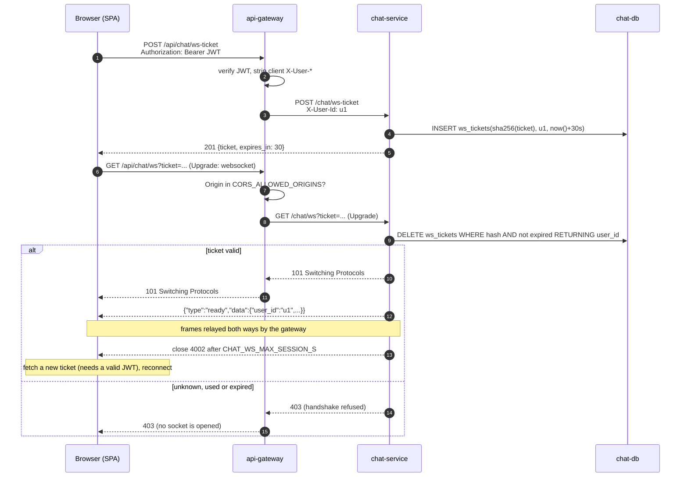
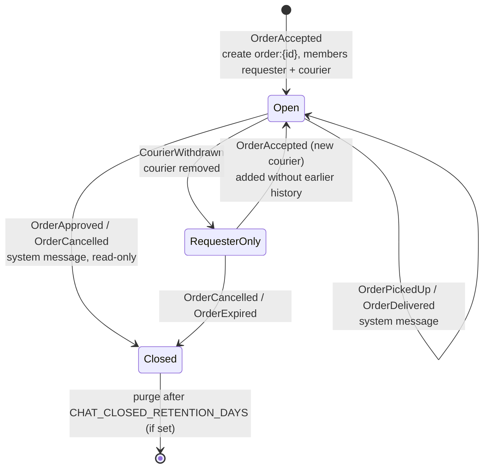
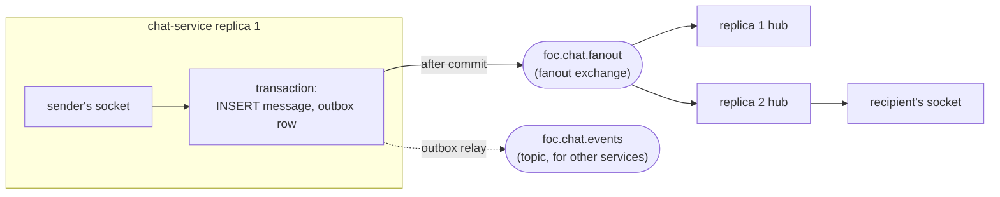

# chat-service architecture

<!-- AI-influenced: diagrams drafted with Claude (Opus 5.5); see ../../ai/usage-log.md -->

## Opening a live connection (WebSocket ticket)

The ticket is the only credential on the WebSocket URL. It is random (32 bytes), stored
hashed, valid for 30 s and deleted when used, so finding it in a log later is useless.
Cross-site WebSocket hijacking is blocked twice: a page on another site cannot obtain a
ticket (it has no JWT, which lives in the SPA's storage, not in a cookie), and the
gateway refuses handshakes from origins outside `CORS_ALLOWED_ORIGINS`.

## Order chat lifecycle (FoC integration)

The order-service does not call the chat-service and does not know it exists. It
publishes the same facts it already publishes for credit-service and
notification-service, and chat-service consumes them from its own durable queue
(`chat-service.order-events`), with a `processed_events` inbox for idempotency.

## Delivery across replicas

Socket frames are published only after the transaction commits, so clients never see
rolled-back data. If a fan-out publish is lost, clients recover through `seq` gap
detection and `GET .../messages?after_seq=`.
