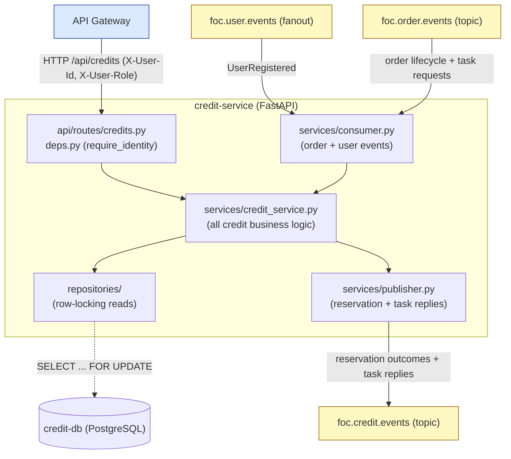

# credit-service architecture

Describes the **current repository**. The credit-service is the authority for
the platform's closed credit economy. It exposes a small synchronous HTTP API
through the gateway and participates in the order-lifecycle saga over RabbitMQ.
See also [`data-model.md`](./data-model.md) and the repo-root
[`docs/architecture.md`](../../docs/architecture.md).

## Component architecture

## Components and responsibilities

| Component | Responsibility |
| --- | --- |
| `app/main.py` | Lifespan: initialize the database then start the RabbitMQ consumer; close both on shutdown. |
| `app/api/routes/credits.py`, `health.py` | Synchronous API for balance, transactions, and the reserve / amend / transfer / release operations. Reads gateway-injected identity. |
| `app/api/deps.py` | `require_identity` from `X-User-Id` / `X-User-Role` (missing role degrades to `client`); dependency injection. |
| `app/services/credit_service.py` | All credit business logic and invariant enforcement. |
| `app/services/consumer.py` | Consumes `UserRegistered` and order-lifecycle / task-request events; idempotent redelivery handling. |
| `app/services/publisher.py` | Publishes reservation outcomes (best-effort) and task replies (retried until delivered). |
| `app/repositories/` | Persistence with `SELECT ... FOR UPDATE` row locking for concurrency safety. |
| `app/models/` | `CreditAccount`, `CreditReservation`, `CreditTransaction`, `CreditTaskResult`. See [`data-model.md`](./data-model.md). |

## External relationships

| Direction | Protocol | Meaning |
| --- | --- | --- |
| Gateway -> Credit API | HTTP JSON, gateway-injected identity | Balance reads and synchronous credit operations by owner or admin. |
| `foc.user.events` -> Credit | AMQP fanout, `UserRegistered` | Provision a credit account with the initial allocation (F1.1). |
| `foc.order.events` -> Credit | AMQP topic | Consume order-lifecycle facts and task requests (reserve / amend / transfer / release). |
| Credit -> `foc.credit.events` | AMQP topic, routing key = event type | Reservation outcomes and definitive task replies, correlated by `task_id`. |

The full event table and request/reply contract are documented in
[`../README.md`](../README.md).

## Invariants

- Balances never negative (N1.1.1): DB `CHECK >= 0` on both balances plus
  sufficiency validation on reserve and amend-increase.
- Atomic and concurrency-safe (N1.2.1 / N1.2.2): every operation commits in one
  transaction; account and reservation rows are read `FOR UPDATE`; the unique
  `order_id` on reservations plus `task_id` idempotency prevent double transfers.
