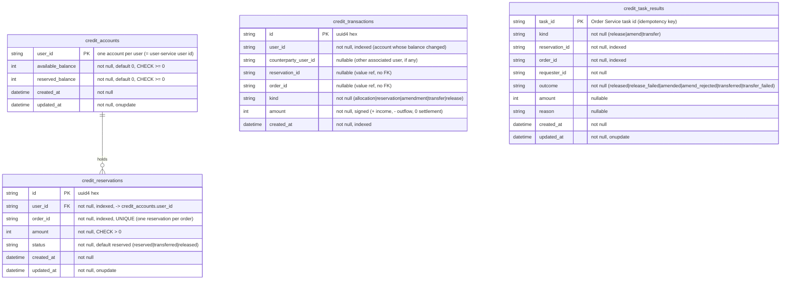
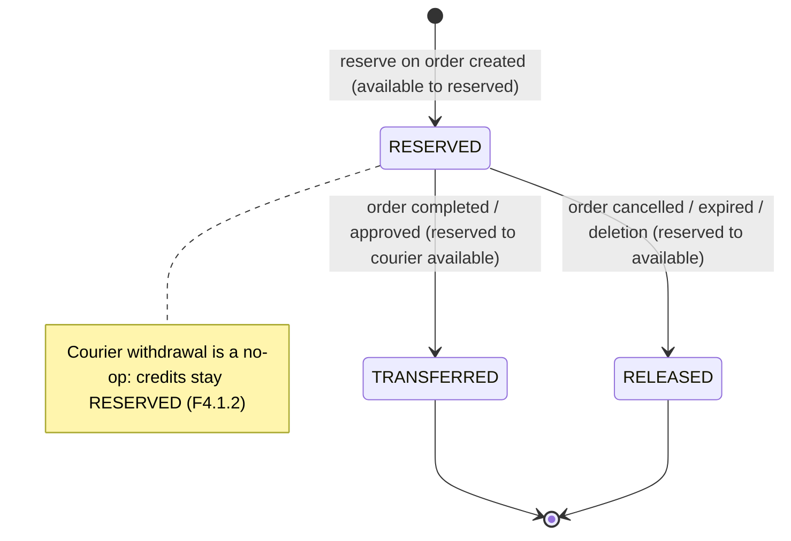

# credit-service Data Model

Data model of **credit-service** only. For how this service fits among the
others, see the repo-root [`docs/architecture.md`](../../docs/architecture.md);
for the API contract and events see [`../README.md`](../README.md).

## Entity-relationship diagram

Every column below is taken directly from the ORM models in `app/models/`.
`credit-db` holds four tables; the service owns this database and never reads
another service's data (DB-per-service).

### Legend

| Notation | Meaning |
| --- | --- |
| `PK` | Primary key. |
| `FK` | Foreign key. |
| `indexed` | Column has a database index. |
| `credit_accounts \|\|--o{ credit_reservations` | One account holds zero or more reservations. |

## Reservation lifecycle

A reservation is created `RESERVED` when an order is placed, then moves to a
single terminal state. The status set is fixed by `ReservationStatus`
(`app/models/reservation.py`); the unique `order_id` makes completion handling
idempotent (Credit F3.2.1).

## Explained elements

- **Balances as invariants.** `available_balance` and `reserved_balance` each
  carry a DB `CHECK >= 0` (Credit N1.1.1). A reservation moves credits from
  available to reserved; a transfer moves them from the requester's reserved
  to the courier's available; a release returns them to available.
- **No cross-database foreign keys.** `user_id`, `order_id`, and
  `counterparty_user_id` are values owned by other services, referenced by id,
  never by a cross-DB FK. Only `credit_reservations.user_id -> credit_accounts.user_id`
  is a real foreign key, because both tables live in `credit-db`.
- **Idempotency by `task_id`.** `credit_task_results` records the outcome of
  each Order Service task so a redelivered event republishes the stored reply
  instead of applying a second release, amendment, or transfer.
- **Signed transaction amounts.** `credit_transactions.amount` is signed:
  positive is income, negative is outflow, zero settles an already-recorded
  outflow. This gives a complete, append-only history (Credit F5).
