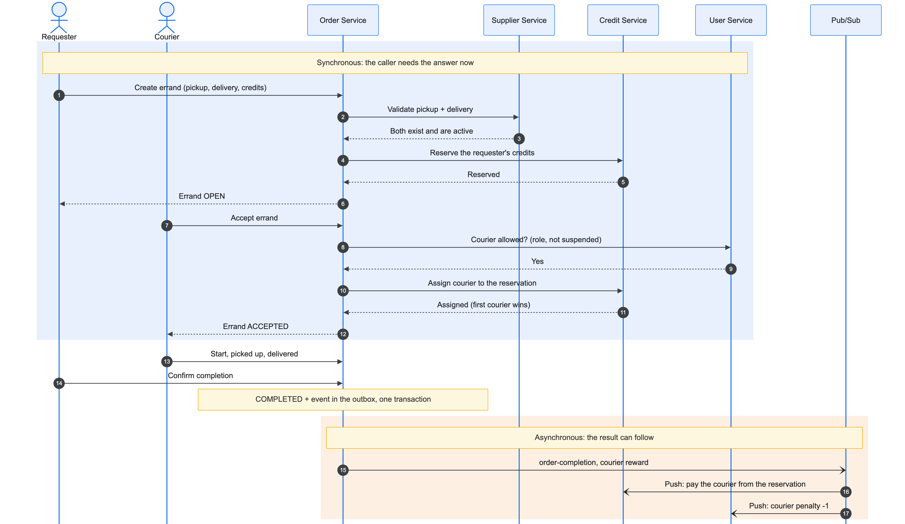
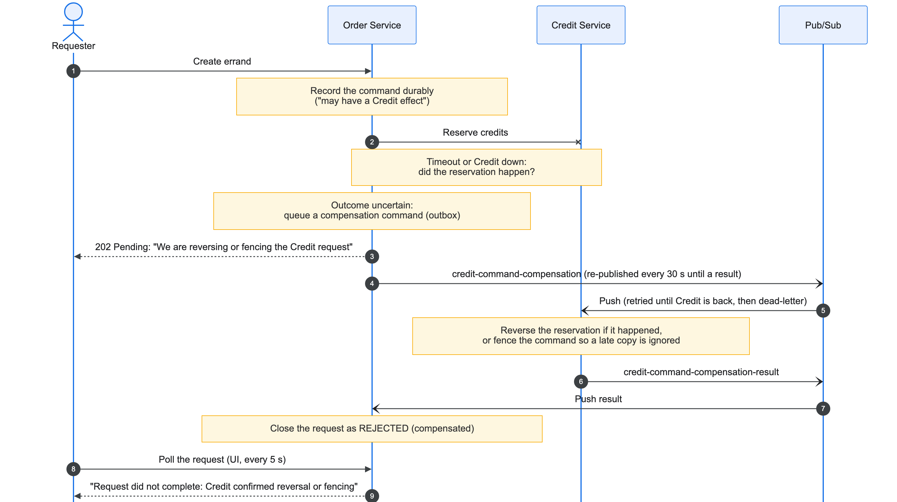

# Architecture, key decisions and scaling

The system diagrams are in the [README](../README.md#architecture), and the pipeline and cloud
runtime diagrams are in [ci-cd.md](ci-cd.md). All diagrams and their sources are in
[diagrams/](diagrams/README.md). This page records why the system is shaped this way,
what each choice costs, and how far it scales. Service-level decisions are in each service's README
and in [order-service/docs/decisions/](../order-service/docs/decisions/).

## Database choices

Each service owns its data (database per service). No service reads another's database. It calls
the other service's API or consumes its events.

| Service | Store | Why | What it costs |
| --- | --- | --- | --- |
| Supplier | Firestore | A small catalogue (about 120 records) that is read far more than written. It's serverless, so there's no instance to run. | Firestore can't do case-insensitive substring search, distance sorting or unique constraints. The service caches the catalogue in memory (≤ 60 s) and searches it there. Uniqueness is enforced by claiming a `supplierKeys/{hash(name + building)}` document in the same transaction. |
| Reporting | Firestore + private Cloud Storage | Report documents and their attachment metadata live in Firestore. The photo bytes go in a private bucket that only the Reporting identity can read. | Photos are streamed through the service (`GET /api/reports/{id}/attachments/{id}`) after an access check, not served straight from storage. |
| Order | PostgreSQL (Cloud SQL) | The order is a state machine with concurrent transitions, e.g. two couriers accepting at once. It needs row locks, constraints, transactions that cover the state change and its outbox event, and Flyway migrations ([ADR-008](../order-service/docs/decisions/ADR-008-order-service-cloud-sql-cloud-run.md)). | It's the one always-on database. Its connections are limited (see [Scaling](#scaling)). |
| Credit | PostgreSQL (Cloud SQL) | This is money. Balances, reservations and the transaction history need ACID updates. Check constraints rule out a negative balance and reserving more than the balance. Commands carry idempotency keys. | It shares the Cloud SQL instance with Order. |
| User | MongoDB Atlas | Profiles are documents (roles, penalty, suspension). The owner chose a managed document store. | It runs outside Google Cloud, so traffic goes through Cloud NAT. The connection string is in Secret Manager. |

## Deployment strategy

- **Cloud Run, one service per container.** Each service deploys and scales on its own, and Google
  manages TLS. Idle services scale to zero, which keeps cost low for a student project. Every
  deploy is an immutable revision, so rolling back is a traffic switch.
  - Rejected: GKE costs a cluster that is always on, and needs more operations work than a
    five-person team can absorb. VMs give no per-service scaling or revisions.
- **Build once, promote the same image.** CI builds each image once, tagged with the commit SHA.
  Staging deploys it on every merge, and production promotes the same image by hand, never
  rebuilding. What was tested is exactly what runs.
- **Health-checked rollouts.**
  - A new revision starts with no traffic and must pass its startup probe.
  - Only then does it take 100% of traffic, and the gateway smoke-tests each service through
    the VPC.
  - A failure leaves the previous revision serving.
- **Staging automatic, production manual.** `main` is always deployable and always live on
  staging. Production changes only when someone decides to promote. For this submission,
  staging is the live environment.
- **Only the gateway is public.** Every other service has internal ingress and is reached over the
  VPC. The gateway also blocks internal-only paths (`/internal/`, Pub/Sub push endpoints, the User
  Service's penalty endpoint).
- **No keys in CI.** GitHub Actions uses Workload Identity Federation. Each Cloud Run service runs
  as its own service account, which can only reach its own databases. A read-only CI check fails a
  PR whose service isn't provisioned yet, so nothing reaches `main` half-deployed.
- **What it costs:**
  - Cold starts of 10–20 s on services that scale to zero.
  - Order, Credit and User run scheduled jobs in-process (expiry, outbox recovery). Those jobs
    only run while an instance has CPU, so these three keep one instance always on
    (`--min-instances=1 --no-cpu-throttling`). That is most of the cloud bill.

## Synchronous or asynchronous

The rule: **call synchronously when the caller can't continue without the answer. Publish an
event when the result can follow.**

- **Synchronous (HTTP):**
  - Creating an order validates both suppliers (are they active?) and reserves the requester's
    credits before the order exists. Accepting an order assigns the courier in Credit first
    ([ADR-017](../order-service/docs/decisions/ADR-017-credit-courier-assignment-before-acceptance.md)).
    If a peer is down, the user gets an error (503) at once, rather than an order that can't be
    paid for.
  - Role checks call the User Service with the caller's token, and only on endpoints that need a
    role. Supplier looks roles up only for admin actions, and checks them on every request, so a
    demoted admin loses access at once. Browsing the catalogue and Order's validation need no role,
    so they keep working even when the User Service is down.
- **Asynchronous (Pub/Sub):**
  - **Order → Credit:** payment on completion and refunds of open orders. Completing an order
    doesn't wait for Credit, and Credit catches up if it was down.
  - **Order → User:** courier penalties.
  - **User → Credit:** the user-created event that grants a new user's starting credits.
  - **Order ↔ Reporting:** report resolution.
  - Push subscriptions retry on their own, and the compensation flow has a dead-letter topic.
- **Transactional outbox:**
  - A service writes the state change and the event to its own database first, then publishes. A
    scheduled scan republishes anything that wasn't acknowledged
    ([ADR-013](../order-service/docs/decisions/ADR-013-transactional-outbox.md)).
  - Delivery is at least once and event IDs are stable, so consumers deduplicate.
  - This avoids the "saved but never announced" and "announced but never saved" failures of
    publishing directly.
- **Compensation between Order and Credit:** when Order can't confirm a Credit command, it records
  the command durably and drives it to a known outcome later, undoing it if needed (Pub/Sub command
  and result topics). It neither retries blindly nor leaves credits stuck. See Order Service
  ADR-054 and ADR-055.

### An errand end to end

The blue band is synchronous: the credits are reserved before the errand exists, and the courier
is assigned in Credit before Order accepts. The orange band is asynchronous: the courier is paid
from the reservation through Pub/Sub.

### Compensation when Credit's outcome is uncertain

## Scaling

| Part | How it scales today | Limit | Next step |
| --- | --- | --- | --- |
| Gateway, frontend, services | Cloud Run adds instances per service with load; they are stateless | `--max-instances=3` per service (a cost guard) | Raise the cap per service; tune per-instance concurrency |
| Cloud SQL (Order, Credit) | One db-f1-micro, a database per service per environment | **25 connections** for both services and both environments, about 20 of them usable. Each instance's Hikari pool is capped at 3 (1 kept idle), so all 3 instances of both services in staging fit (18). Hikari's default of 10 ran out on every rollout | For the Order and Credit owners: a larger tier or connection pooling, a separate instance, regional HA (it is zonal now) |
| Firestore (Supplier, Reporting) | Serverless | Effectively none at this size | – |
| Pub/Sub | Serverless; push subscriptions scale with the consumer | Consumer throughput | – |
| Scheduled jobs | Run in every instance of Order, Credit and User | More instances means more runs. Order's outbox claims rows with `FOR UPDATE SKIP LOCKED`, so its instances share the work instead of repeating it | Move the jobs to Cloud Scheduler calling an endpoint, so they run once and the services can scale to zero |
| Supplier catalogue cache | In memory, per instance, ≤ 60 s | Each instance may be up to 60 s behind an admin edit; reads by ID always go to Firestore | A shared cache (Memorystore) if the catalogue grows large |
| User Service role lookups | Every role-checked request in another service calls it, including Supplier's admin actions (Supplier caches roles only for the UI's permission check) | It's on the hot path for Order, Credit and Reporting | Cache roles in every caller, or put roles in Firebase custom claims |

The first bottleneck is the database's connection count, not Cloud Run. It shows in Cloud SQL's
`num_backends` metric, and when it runs out Postgres refuses new connections ("remaining connection slots
are reserved"). The pools are sized for staging only: deploying production to the same instance needs a larger
tier or a separate instance. Database scaling belongs to the Order and Credit owners (#114).
