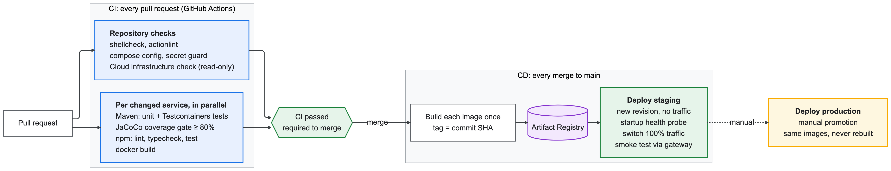
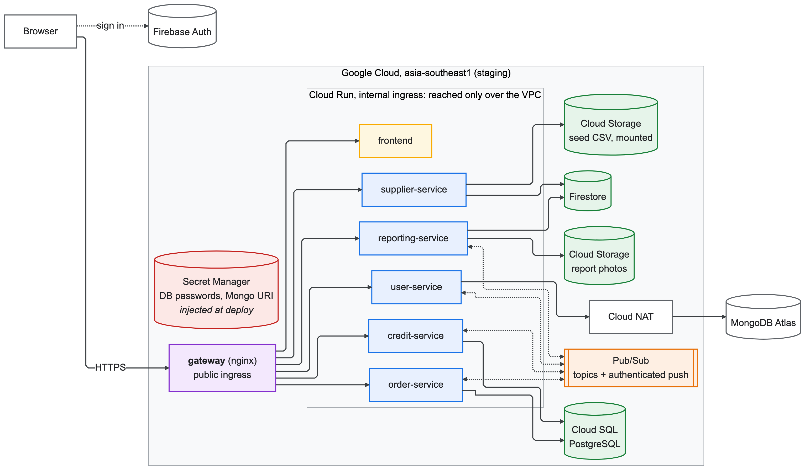

<!--
AI Assistance Disclosure:
Tool: OpenAI Codex (GPT-5), date: 2026-10-13
Mode: Documentation.
Scope: Documented Reporting Service deployment, storage ownership, and infrastructure requirements.
Author review: I reviewed for correctness.
-->

# CI/CD and cloud deployment

## Shared Java library build (CHANGE-130, 2026-10-15)

`foc-common/` is a non-deployed Maven penalty-policy library. Order is its first
consumer. Root reactor/wrapper builds common before Order with
`bash ./mvnw -pl order-service -am verify` (Windows: `.\mvnw.cmd` with same args).
CI detects the dependency and uses the reactor. Other services remain standalone.
Common/root Maven/ignore changes conservatively select all Maven backends;
`bash scripts/ci/test-list-services.sh` checks this against isolated Git fixtures.

Order and User build their images from the repo root (`docker build -f
order-service/Dockerfile .`), because their Dockerfiles copy `foc-common`.
`scripts/ci/build-context.sh <service>` decides the context for CI and the staging deploy. It picks
the repo root when a Dockerfile copies `foc-common/` or `<service>/` paths. CI and the deploy
therefore can't drift apart: on Nov 2 they did, and CI built User from the root while the deploy
built it from its folder and failed. Compose sets the same contexts in `compose.yaml`. The root
allowlist `.dockerignore` excludes credentials, local databases and generated files. Production
still promotes the exact staging image.


Owner: Zheng Jiongjie. This is the runbook for the FoC pipelines (NTH5).

## Overview

### Pipeline



### Runtime (one environment)



The pipeline authenticates to Google Cloud with Workload Identity Federation, so GitHub holds no
service-account keys. Each Cloud Run service runs as its own identity (`foc-<service>@`), which can
only reach its own databases.

| Environment | Trigger | Cloud Run services | Firestore databases |
| --- | --- | --- | --- |
| local | `docker compose up` | – (containers) | Firestore emulator |
| staging | every push to `main` | `<service>-staging` | `<name>-staging` |
| production | manual **Deploy production** | `<service>-production` | `<name>-production` (delete-protected) |

- GCP project `protean-vigil-509704-q4`, region `asia-southeast1` (Singapore), images in
  Artifact Registry `asia-southeast1-docker.pkg.dev/protean-vigil-509704-q4/foc/<service>`.
- Public entry point per environment: the gateway,
  `https://gateway-<environment>-374055363871.asia-southeast1.run.app`. Staging:
  https://gateway-staging-374055363871.asia-southeast1.run.app.
- **Only the gateway is public.** Every other Cloud Run service (backends and frontend) has
  **internal ingress**: it only accepts requests from the project's VPC and from Pub/Sub push. The
  gateway, and every service that calls another (Order, Credit, Supplier, Reporting), sends its traffic through the
  VPC with Direct VPC egress (`foc-vpc` / `foc-run-asia-southeast1`, Private Google Access on), so
  those calls count as internal. Internet-bound traffic from them (e.g. Cloud SQL's public IP) leaves
  through Cloud NAT (`foc-nat`). Opening a backend's own `*.run.app` URL returns 404.

## Workflows

### CI (`.github/workflows/ci.yml`)

Runs on pull requests and pushes to non-main branches, and is reused by the staging
deploy. `scripts/ci/list-services.sh` selects the services whose folder changed (all of
them if `.github/`, `scripts/ci/` or `infra/` changed). Per service:

- Maven project: `./mvnw -B verify` (unit + Testcontainers integration tests + JaCoCo
  ≥ 80% line and branch). The coverage report is uploaded as an artifact.
- npm project: `npm ci`, lint, type-check, `npm test` if present.
- Always: `docker build` of the service's own `Dockerfile`.

Plus two cross-cutting jobs:

- **Repository checks:** shellcheck, actionlint (a pinned, checksum-verified release,
  downloaded with retries, or the same version's digest-pinned Docker Hub image when GitHub's
  release downloads are down), `docker compose config`, and a guard that fails if
  credential-like files are tracked.
- **Cloud infrastructure** (`scripts/ci/check-infra.sh staging production`), a read-only
  check through Workload Identity Federation that every deployable service has:
  - its runtime identity `foc-<service>@`, which the deployer may deploy as;
  - if it uses Firestore: databases `<name>-staging` and `<name>-production`, with access
    granted to that identity only;
  - the config buckets;
  - Reporting Service's private attachment bucket, public-access prevention, and bucket-scoped object permission.

  A new service therefore fails its PR, not a deploy, until the bootstrap has provisioned it.
  The check uses the custom role `focInfraReader`, which can read metadata and IAM policies
  but never data or settings.

The **CI passed** job aggregates everything and is the single required status check for `main`.

### Deploy staging (`.github/workflows/deploy-staging.yml`)

On every push to `main`: CI → build and push one image per service tagged with the commit
SHA → `scripts/ci/deploy.sh staging <sha>`.

### Deploy production (`.github/workflows/deploy-production.yml`)

Manual (**Actions → Deploy production → Run workflow**). With no input it promotes the
commit currently tagged `staging`; or give a full commit SHA. It verifies all images exist,
checks out that commit for the deploy configuration, re-runs the infrastructure check for
production, and runs `scripts/ci/deploy.sh production <sha>`. Images are **never rebuilt** for production.
To require approval before each production deploy, add required reviewers to the
`production` GitHub environment (not configured yet).

## How a rollout works (`scripts/ci/deploy.sh`)

For each service (backends → frontend → gateway):

1. Run `<service>/deploy/pre-deploy.sh` if present (e.g. upload seed files).
2. Render env vars: standard runtime variables (AGENTS.md §4) + `<service>/deploy/env.yaml`
   (envsubst with `infra/environments/<env>.env` and every `<SERVICE>_URL`).
3. `gcloud run deploy` as the service's own identity `foc-<service>@`. If the identity
   doesn't exist, the deploy stops rather than using the project's default identity. For an existing
   service the new revision gets **no traffic** and a `sha-xxxxxxx` tag URL.
4. Health check. Every revision has an HTTP startup probe on `HEALTH_PATH`, so Cloud Run only
   marks it ready once the service answers. The deploy fails otherwise. The gateway (the only public
   service) is also curled on its tagged URL (12 tries, 5 s apart).
5. Healthy → switch 100% of traffic to it. Unhealthy → the previous revision keeps serving, and the
   remaining services **still roll out**; the job fails at the end, naming what wasn't deployed.
   Order is the exception: if the gateway or a provider deployed before it (User, Supplier, Credit)
   fails, Order is skipped, because it must not run ahead of them.
6. After all services: smoke-test each deployed one **through the public gateway** (its
   `/api/<name>s/v3/api-docs`, the frontend's `/health`). This proves the gateway can reach it
   over the VPC.
7. Then tag the deployed images `<environment>` in Artifact Registry. A service that wasn't
   deployed keeps the tag of the revision that is still serving.

`scripts/ci/test-deploy.sh` checks this failure handling in CI with a fake `gcloud`.

### Per-service deploy config

| File | Purpose |
| --- | --- |
| `<service>/deploy/service.conf` | bash: `HEALTH_PATH` (default `/actuator/health`), `EXTRA_FLAGS=(--memory=512Mi ...)`, `INGRESS` (default `internal`; `all` for the gateway), `VPC_EGRESS` (`all-traffic` if the service calls other services), `GATEWAY_PATH` (smoke-test path through the gateway) |
| `<service>/deploy/env.yaml` | extra env vars; `${VARS}` from `infra/environments/<env>.env` and `<SERVICE>_URL`s |
| `<service>/deploy/pre-deploy.sh` | optional executable hook, receives `ENVIRONMENT` |

Service URLs are deterministic (`https://<service>-<env>-<project-number>.<region>.run.app`),
so any service can reference another as `${SUPPLIER_SERVICE_URL}` etc.

### Logs

Backend services write one JSON object per line to stdout, and Cloud Logging indexes it under
`jsonPayload`. `deploy.sh` sets the format for every backend:

| Setting | Value | Why |
| --- | --- | --- |
| `LOGGING_STRUCTURED_FORMAT_CONSOLE` | `logstash` | Flat JSON. Key-value pairs (`log.atInfo().addKeyValue(...)`) and MDC values such as `requestId` become top-level fields. |
| `LOGGING_STRUCTURED_JSON_RENAME_LEVEL` | `severity` | Cloud Logging reads a top-level `severity` as the entry's level, so `severity>=WARNING` works. |
| `LOGGING_STRUCTURED_JSON_EXCLUDE` | `@version,level_value` | Noise |

Until Nov 4 the format was ECS, which caused two problems:
- ECS nests the level under `log.level`, so every entry showed as DEFAULT.
- ECS reserves the top-level `service` object, so logback dropped every line that added its own
  `service` key ("The name 'service' has already been written"). Order's `order_action` and
  `peer_dependency` lines and all of Credit's business lines were lost that way.

## Rollback

Traffic can be moved back to any earlier revision instantly:

```bash
gcloud run revisions list --service supplier-service-production --region asia-southeast1
gcloud run services update-traffic supplier-service-production --region asia-southeast1 \
  --to-revisions <revision-name>=100
```

Or re-run **Deploy production** with an older commit SHA (its images are still in the registry).

## Security model

- **No long-lived keys in GitHub.** Workflows authenticate with Workload Identity Federation:
  GitHub's OIDC token is exchanged for short-lived credentials of `foc-deployer@`, and only
  this repository (`Y2627S1-CS3219-P-28/FoC-P28`) is trusted.
- **Deployer permissions.** `foc-deployer@` has only what rollouts need:
  - `run.admin` on the project;
  - `artifactregistry.repoAdmin` on the `foc` repository (moving the `<environment>` tag deletes it from the previous image, which the writer role can't do);
  - `iam.serviceAccountUser` on each runtime identity;
  - `storage.objectAdmin` on the config buckets.
- **Least privilege at runtime.** Each Cloud Run service runs as `foc-<service>@`, which can
  only access its own Firestore databases (IAM condition on the database name). Reporting Service is
  additionally the sole runtime identity with object access to its private per-environment attachment bucket.
- **Config vs secrets.** Non-secret settings are committed in `infra/environments/*.env`.
  Secrets go in Secret Manager and are mounted with `--set-secrets` in `EXTRA_FLAGS`: the Order and
  Credit database passwords, and the User Service's MongoDB Atlas connection string
  (`user-mongodb-uri-<environment>`; `bootstrap.sh` creates it, the owner adds the value with
  `printf '%s' "$URI" | gcloud secrets versions add user-mongodb-uri-<environment> --data-file=-`).

## One-time setup (already done for this project)

```bash
gcloud auth login   # or activate an owner service account
infra/gcp/bootstrap.sh
infra/gcp/configure-order-pubsub.sh staging      # Order topics + publisher access, per environment
infra/gcp/configure-order-pubsub.sh production
infra/gcp/configure-credit-pubsub.sh staging     # User topic + Credit push subscriptions (after credit-service is deployed)
infra/gcp/configure-credit-pubsub.sh production
infra/gcp/configure-compensation-pubsub.sh staging     # Compensation request/result topics, push subscription and DLQ
infra/gcp/configure-compensation-pubsub.sh production
```

`configure-compensation-pubsub.sh` runs the Order and Credit provisioning scripts first, then
adds the Order-to-Credit compensation request flow and the Credit-to-Order result flow. Use it when
the infrastructure check reports missing compensation topics, subscriptions or dead-letter paths.

Each environment has its own Order and user-created topics (`*-staging-v1`, `*-prod-v1`). Local runs
use Docker-emulator `*-local-v1` topics, which no cloud environment subscribes to, so a laptop can
never deliver events to staging.

The script is idempotent and works out its service lists from the repository: every service
folder gets a runtime identity, and every service using the Firestore client gets its
databases. Re-run it whenever the **Cloud infrastructure** CI check reports something missing
(typically after a new service is added). It needs an owner-level account, which is why CI
only checks and never provisions: provisioning grants IAM roles, and letting CI do that
would let any merge escalate to project owner.

In GitHub, `main` is protected: merges need a pull request with a green **CI passed** check.
Adding required reviewers to the `production` environment is optional.

## Troubleshooting

| Symptom | Cause and fix |
| --- | --- |
| Smoke test gets **404 on `/healthz`** although the service runs | Cloud Run reserves some paths ending in `z`. Use a path like `/health`. |
| UI loads but data requests get **404 on `/api/...`** | The page was opened on a service's own URL instead of the gateway. Use the gateway URL (the frontend now redirects there). |
| **404 from a service's own `*.run.app` URL** | Expected: only the gateway is public. Use `<gateway>/api/<name>s/...`, e.g. the API docs at `<gateway>/api/suppliers/docs`. |
| A service gets **404/403 calling another service** | The caller needs `VPC_EGRESS=all-traffic` in its `deploy/service.conf`, because internal services only accept traffic that comes through the VPC. |
| **Smoke test failed** (not reachable through the gateway) | The gateway can't reach the service over the VPC (check the gateway's `VPC_EGRESS`, the subnet's Private Google Access, and `check-infra.sh`). Roll back as described below. |
| Rollout succeeded but the job failed on `artifacts docker tags add` (`tags.delete` denied) | The deployer needs `artifactregistry.repoAdmin` on the repository (in `bootstrap.sh`). |
| Sign-up fails in the cloud but works locally | The cloud Firebase project enforces a password policy; the emulator doesn't. The sign-up form lists the rules. |
| **Repository checks** fails installing actionlint (`Connection reset`, `./actionlint: No such file`) | A network blip while downloading. The step retries and verifies a pinned release, and falls back to the pinned Docker Hub image if GitHub's release downloads stay down. If both fail, re-run the job. |
| **Cloud infrastructure** check fails on a PR | A service is missing its identity, databases, access or Pub/Sub wiring (usually a new service or event flow). The CI/CD owner runs `infra/gcp/bootstrap.sh`, then `infra/gcp/configure-compensation-pubsub.sh staging` and `infra/gcp/configure-compensation-pubsub.sh production`, and re-runs the job. |
| Deploy fails with "Missing runtime identity" | Same cause, caught at deploy time. `deploy.sh` never falls back to the default (over-privileged) identity. |
| First request is slow | Services scale to zero; a cold start takes 10–20 s. Set `--min-instances=1` in `EXTRA_FLAGS` for demos. |
| A deploy failed ("Partly deployed") | The services it names keep their previous revision; the others are out. Fix the problem and re-run the failed job (`gh run rerun <id> --failed`), or push a fix. |
| Order or Credit fails its startup probe with `remaining connection slots are reserved` | The shared `order-postgres` instance is out of connections (#114). Both services cap their Hikari pool at 3 in `deploy/env.yaml`, and `test-order-workflows.py` checks that every instance of both fits in about 20 connections. If you raise a pool or `--max-instances`, keep within that budget. The other services still deploy. |
