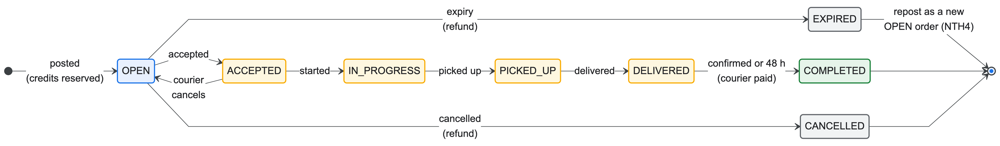

# D4 demo runbook

The plan for the final demo (Nov 11–14), based on the mentor's notes:
- realistic names and data;
- the main use cases, not sign-up;
- meaningful edge cases;
- logs;
- every nice-to-have;
- the architecture and deployment diagrams;
- who to ask about what.

Everything runs on **staging**: https://gateway-staging-374055363871.asia-southeast1.run.app

The diagrams are in the [README](../README.md#architecture) and [ci-cd.md](ci-cd.md#overview).
Answers to "why" and "does it scale" questions are in [architecture.md](architecture.md).

## Before the demo

- **Accounts with realistic names.** Create them the day before, not live; sign-up is not what we
  demo. Suggested accounts (any `@u.nus.edu` addresses you control):

  | Account | Use |
  | --- | --- |
  | Tan Wei Ming | requester |
  | Nur Aisyah Rahman | courier |
  | Rahul Menon | second courier, for the race |
  | Chloe Lim | admin |

  - Promote the admin from the admin pages using an existing admin account.
  - New accounts get their starting credits through the `user-created` event.
- **Data in place.** The supplier catalogue has 120 real campus places (Kent Ridge, UTown, NUH Medical
  Centre). Before the demo, create a few orders in different states, so that lists, history and the admin
  dashboard aren't empty:
  - one OPEN order with an expiry 30–45 minutes after the demo starts;
  - one DELIVERED;
  - one with an open report.
- **Warm up.** About five minutes before, open the gateway and click through each page. Supplier,
  Reporting, the frontend and the gateway scale to zero, and a cold start takes 10–20 s.
- **Logs.** Keep a Logs Explorer tab open (project `protean-vigil-509704-q4`) with the queries below
  saved.
- **Rehearse once on staging.** Some rejections show a different message locally, because local
  Compose uses Order's "retry" recovery mode and staging uses "compensate".

## Main flows (show these first)

The order states these flows walk through:

1. **Find a place.** As the requester, open Suppliers.
   - Search "coffee".
   - Filter by type (Food/Coffee, Landmark).
   - Sort by distance from a point.
   - Open one supplier to show its hours and location.
2. **Request an errand.** Choose a pickup (e.g. Flavours @ UTown) and a delivery point (e.g. Tembusu
   College), set a reward and an expiry, and submit.
   - Order validates both places with the Supplier Service and reserves the credits in the Credit
     Service before the order exists.
   - Show the balance: available credits go down by the amount reserved.
3. **Accept and deliver.** As a courier, browse errands and accept.
   - Credit records the courier first, then Order accepts.
   - Start, pick up, deliver.
4. **Complete.** As the requester, press "Complete order". Order publishes `order-completion`,
   Credit pays the courier from the reservation, and both balances and transaction histories update.
5. **Admin (NTH1).**
   - The dashboard shows all orders, users, suppliers and reports.
   - Create a supplier, edit it, deactivate it. A deactivated supplier stays visible but can't be
     chosen.

## Edge cases worth showing

| Case | How to show it | What happens | Where it's enforced |
| --- | --- | --- | --- |
| Two couriers accept the same errand | Two browsers (Nur Aisyah, Rahul) press Accept together | One wins. The other gets "Order version is stale", or "This order has an unresolved request. Please wait." if the first is still in flight. | Order row lock and version check; Credit refuses a second courier on the reservation |
| Not enough credits | The requester posts an errand worth more than their available balance | Rejected; nothing is reserved | Credit (check constraints and a reservation check); Order reports the rejection |
| Supplier deactivated while a request is being written | Open the new-request form, then deactivate the pickup as admin in another tab, then submit | "The selected pickup or delivery location is no longer available. Choose active, different locations." Existing orders are unaffected. | Supplier `/validate` → Order |
| Suspended courier (NTH2) | As admin, apply the "theft" penalty (10 points) to a courier's order, and let the requester complete it. Then that courier tries to accept | "Your courier access is suspended. You cannot accept new errands, but you can continue errands already assigned to you." The profile shows "Suspended". | Penalty event over Pub/Sub → User Service suspends at 10 points for a month → Order checks before accepting |
| Report holds an order (NTH3) | The requester reports a delivered order, then tries to complete it | Completion is refused while the report is open. The admin resolves the report, which releases the hold. | Reporting → Order report hold |
| Expiry, refund and repost (NTH4) | The OPEN order set up earlier passes its expiry | Within a minute it becomes EXPIRED and the reserved credits come back through `open-order-refund`. If it was posted with automatic repost, a new linked order appears; otherwise repost it by hand. | Order's per-minute scheduler → Pub/Sub → Credit |

Notes:
- Expiry is at least 30 minutes after posting, so prepare that order before the demo starts.
- Automatic completion after 48 hours can't be shortened. In the demo, the requester completes.
- "Requester accepts their own errand" is enforced (by Order and Credit), but the UI hides your own
  errands, so it can only be shown with `curl`. Skip it unless asked.
- Credit being unavailable (compensation) has no switch to trigger it. Explain it with the
  diagram instead: Order marks the request uncertain, publishes a compensation command, and Credit
  reverses or fences it. The user sees "We are reversing or fencing the Credit request. Please wait."

## Showing logs

Logs Explorer, project `protean-vigil-509704-q4`. Services log JSON lines. Cloud Logging reads their
`severity` as the entry's level, and every other field appears under `jsonPayload`.

| Show | Query |
| --- | --- |
| One service's log | `resource.type="cloud_run_revision" resource.labels.service_name="order-service-staging"` |
| A request through the gateway (status, latency, trace) | `resource.labels.service_name="gateway-staging" httpRequest.requestUrl:"/api/orders"` |
| Pub/Sub deliveries (push requests from Google) | `resource.type="cloud_run_revision" httpRequest.userAgent:"APIs-Google"` |
| Order lifecycle audit (create, accept, expire, complete) | `resource.labels.service_name="order-service-staging" jsonPayload.message="order_action"` |
| Credit money movements (reserve, assign, pay, refund) | `resource.labels.service_name="credit-service-staging" (jsonPayload.message:"credits_" OR jsonPayload.message:"credit_reservation")` |
| Order scheduler (expiry, auto-complete) | `resource.labels.service_name="order-service-staging" jsonPayload.logger_name:"OrderLifecycleScheduler"` |
| Supplier catalogue changes and rejected pickup/delivery pairs (the deactivation edge case) | `resource.labels.service_name="supplier-service-staging" (jsonPayload.action:"SUPPLIER_" OR jsonPayload.action="PAIR_REJECTED")` |
| Supplier seed on startup | `resource.labels.service_name="supplier-service-staging" jsonPayload.message:"Supplier seed"` |
| Warnings and errors, all services | `resource.type="cloud_run_revision" severity>=WARNING` |

Rehearse these. Order's `order_action` and Credit's `credits_*` lines appear only after someone has
created or changed an order. They also only appear for activity after the Nov 4 deploy: before it, the
cloud's ECS log format dropped every line that carried its own `service` field, and these lines do
(see [ci-cd.md](ci-cd.md#logs)).

The Pub/Sub query is the clearest way to show the async flows. After you complete an order, it shows
Credit receiving the completion event, and Credit's query then shows `credits_transferred`. After a
penalty, it shows the User Service receiving it.

## Nice-to-haves to show

| NTH | Owner | Shown in |
| --- | --- | --- |
| NTH1 Administrator dashboard | Tham Yao Xiang | Main flow 5, report resolution |
| NTH2 Penalty system | Oh Yi Xian | Suspended-courier edge case |
| NTH3 Report system | Khoo Yu Yien | Report-hold edge case |
| NTH4 Errand reposting | Choong Weng Sheng | Repost after expiry |
| NTH5 CI/CD and cloud deployment | Zheng Jiongjie | The pipeline diagram, a recent **Deploy staging** run in GitHub Actions, and the fact that the demo itself runs on Cloud Run |

## Who answers what

| Topic | Ask |
| --- | --- |
| Order lifecycle, admin dashboard, reports integration | Tham Yao Xiang |
| Order–Credit compensation, recovery, reposting, order UI | Choong Weng Sheng |
| Credit Service, Reporting Service | Khoo Yu Yien |
| User Service, sign-in, roles, penalties and suspension | Oh Yi Xian |
| Supplier Service, CI/CD, cloud infrastructure, scaling | Zheng Jiongjie |

## Questions to expect

- **What happens on a merge?** CI (tests, an 80% coverage gate, image builds, infrastructure checks)
  must pass. Then each image is built once, tagged with the commit SHA, and deployed to staging
  behind a health check. Production promotes the same images by hand. See
  [ci-cd.md](ci-cd.md#pipeline).
- **How do you roll back?** Move traffic to the previous Cloud Run revision. It's instant, because
  revisions are immutable.
- **Does it scale?**
  - The stateless services scale out on Cloud Run.
  - Firestore and Pub/Sub are serverless.
  - The first limit is the shared Cloud SQL instance's 25 connections, which Order and Credit
    share. Each instance's pool is capped at 3 so that staging fits; production would need a
    larger tier or its own instance. The Order and Credit owners answer how their services handle it.
  - In-process schedulers would move to Cloud Scheduler.
  - Details: [architecture.md](architecture.md#scaling).
- **Why async here and sync there?** See [architecture.md](architecture.md#synchronous-or-asynchronous).
