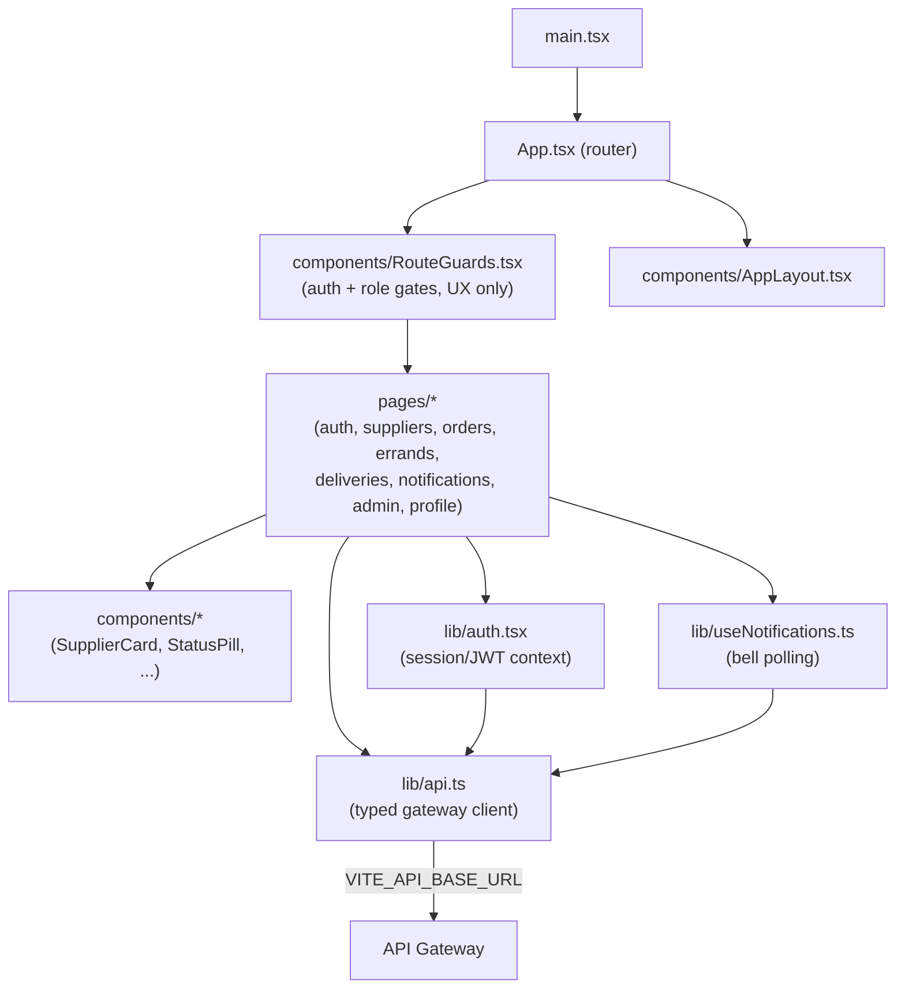

# frontend architecture

Describes the **current repository**. The frontend is a React + TypeScript +
Vite single-page app built with Mantine. It talks only to the API Gateway; it
holds no business logic and enforces no authorization (the server does). See
[`../README.md`](../README.md) for routes, config, run, and test instructions.

## Structure

## Modules

| Area | Responsibility |
| --- | --- |
| `src/App.tsx`, `main.tsx` | App bootstrap and route table (lazy-loaded pages). |
| `src/components/RouteGuards.tsx` | Redirect unauthenticated users and hide admin routes from clients. These are UX affordances only; the gateway and services enforce real authorization. |
| `src/components/AppLayout.tsx` | Shell: nav, header, credits widget, notification bell. |
| `src/pages/*` | One folder per domain area (auth, suppliers, orders, errands, deliveries, notifications, admin, profile). |
| `src/lib/api.ts` | Single typed HTTP client pointed at `VITE_API_BASE_URL`; attaches the JWT. |
| `src/lib/auth.tsx` | Session context: login, logout, current user and role. |
| `src/lib/useNotifications.ts` | Polls the notification read API for the bell. |
| `src/lib/types.ts`, `theme.ts` | Shared DTO types and the Mantine theme. |

## Data flow

The app sends every request through `lib/api.ts` to the gateway at
`VITE_API_BASE_URL`. The gateway authenticates the JWT, injects trusted
identity headers, and routes to the owning service. Responses hydrate page
state. The SPA never calls a backend service directly and never trusts its own
role checks for security.

## Testing

End-to-end specs use Playwright with the gateway mocked at the network layer
(`tests/support/api-mocks.ts`), so no backend or database is needed. See
[`../README.md`](../README.md) for commands.
