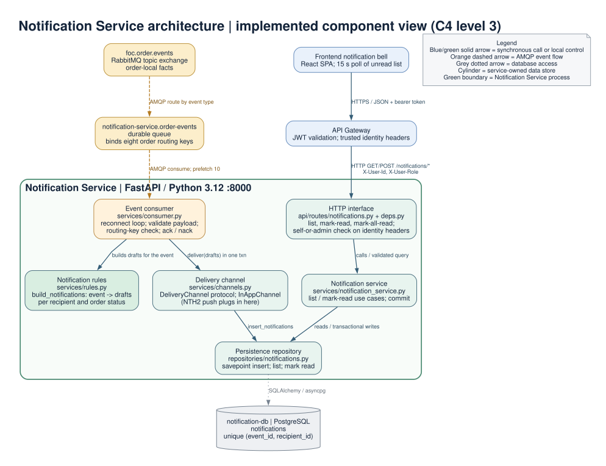

# Notification Service architecture

This document describes the **implemented notification-service codebase** on `main`.
It is the primary event-driven consumer in FoC (project M6).
The service turns order-lifecycle events into per-recipient, user-visible notifications and serves them back over a small read API.

## Purpose

Order Service owns the errand lifecycle and publishes facts about its own state to RabbitMQ.
Notification Service subscribes to those facts, decides who should hear about each one, and stores a notification row per recipient.
The frontend bell polls the read API so a requester or courier sees progress on their orders without refreshing a page.
Delivery is asynchronous and must never block the upstream order or credit operation.

## Responsibilities (F1-F4)

- **F1** subscribe to Order Service events and consume them asynchronously, persisting one notification per recipient.
- **F2** notify the **requester** of progress on their own orders.
- **F3** notify the **courier** of changes to orders assigned to them.
- **F4** notify **both** parties when an order is cancelled by a supplier deactivation.

## Component architecture (C4 level 3)

[Editable Graphviz source](./notification-service-architecture.dot)

Regenerate the vector image from its editable source with `dot -Tsvg notification-service/docs/notification-service-architecture.dot -o notification-service/docs/notification-service-architecture.svg`.

**Scope.**
The green boundary is the single FastAPI Notification Service process.
The blue boxes are external clients or edge services; the yellow boxes are the RabbitMQ topic exchange and the service's own durable queue; the cylinder is the service-owned PostgreSQL database.
The diagram shows source-level components inside Notification Service, not the internals of Order Service or the gateway.

| Notation | Meaning |
| --- | --- |
| Blue or green solid arrow | Synchronous HTTP call or local control call; its label states the operation or purpose. |
| Orange dashed arrow | Asynchronous AMQP event flow through the broker; the arrow follows data movement. |
| Grey dotted arrow | Data access to the service-owned database. |
| Green outline around internal components | Notification Service deployment and component boundary. |
| Cylinder | The service-owned PostgreSQL database; no other service reads it. |

**Acronyms.**
C4 = Context, Container, Component, Code.
API = application programming interface.
HTTP = Hypertext Transfer Protocol.
JSON = JavaScript Object Notation.
AMQP = Advanced Message Queuing Protocol.
JWT = JSON Web Token.
SSE = Server-Sent Events.
NTH2 = nice-to-have item 2 (real-time push).

### Components and responsibilities

| Component | Implemented responsibility |
| --- | --- |
| `app/services/consumer.py` | Long-running consumer started from the app lifespan. Declares the topic exchange and the durable queue, binds the eight order routing keys, validates each message, checks the routing key against the payload, and acknowledges only after a committed write. A reconnect loop survives broker outages so `/health` stays up. |
| `app/services/rules.py` | Pure `build_notifications(event, event_id)` function. Maps each order event to a list of notification drafts, one per recipient, with the recipient id, order status, title, and body. Holds `SUPPLIER_DEACTIVATION_REASON`. No I/O. |
| `app/services/channels.py` | `DeliveryChannel` protocol and the default `InAppChannel`. The channel is the single extension point where a future push transport plugs in. |
| `app/repositories/notifications.py` | PostgreSQL access to the `notifications` table: idempotent insert via a per-row savepoint, recipient listing with counts, and mark-read / mark-all-read. |
| `app/services/notification_service.py` | Read-side use cases for the HTTP layer: list, mark one read, mark all read; commits after a write. |
| `app/api/routes/notifications.py`, `app/api/deps.py` | Exposes the read API, reads the gateway-injected identity headers, and enforces the self-or-admin rule. Keeps HTTP concerns out of the services layer. |
| `app/models/notification.py` | The `Notification` ORM model, its unique constraint, and its listing index. |

### External relationships

| Direction | Protocol / contract | Meaning in the current code |
| --- | --- | --- |
| `foc.order.events` -> `notification-service.order-events` -> consumer | AMQP topic exchange, durable queue, eight routing-key bindings | Order Service publishes order facts; the broker routes matching ones into the service-owned queue; the consumer reads them with a prefetch of 10. |
| Frontend bell -> API Gateway -> routes | HTTPS/HTTP JSON; bearer JWT at the gateway; `X-User-Id` and `X-User-Role` forwarded | The bell polls the unread list every 15 seconds. The gateway is the only public entry point and injects the trusted identity headers. |
| Repository -> `notification-db` | SQLAlchemy over asyncpg | The service owns this PostgreSQL database and never reads another service's data. |

## Event to recipient to status mapping

`build_notifications` is the whole policy.
Each inbound event produces zero or more notifications, each with a recipient and the order status the notification reflects.

| Event | Order status stored | Recipient(s) |
| --- | --- | --- |
| `OrderAccepted` | `ACCEPTED` | requester |
| `OrderPickedUp` | `PICKED_UP` | requester |
| `OrderDelivered` | `AWAITING_APPROVAL` | requester |
| `OrderApproved` / `OrderCompleted` | `COMPLETED` | requester, plus courier when `courier_id` is set |
| `CourierWithdrawn` | `OPEN` | requester |
| `OrderExpired` | `EXPIRED` | requester |
| `OrderCancelled` (requester cancel) | `CANCELLED` | courier, only when `courier_id` is set; no notification otherwise |
| `OrderCancelled` (supplier deactivation) | `CANCELLED` | requester, plus courier when `courier_id` is set |

A requester-initiated cancellation only notifies the assigned courier, because the requester performed the action themselves and does not need to be told.
When no courier is assigned, that branch produces no notification at all.
The supplier-deactivation branch is distinguished by matching the event `reason` against `SUPPLIER_DEACTIVATION_REASON` (`^Supplier .+ deactivated\.$`), which mirrors the reason string Order Service writes.
The deactivation message deliberately omits the supplier id so one requester cannot learn another supplier's internal identifier.

## Idempotency

Redelivery is normal with an at-least-once broker, so the same event can arrive more than once.
Three mechanisms together guarantee that a redelivered event never produces a duplicate user-visible notification (N1.1).

- **Unique constraint.** `notifications` is unique on `(event_id, recipient_id)`. A second row for the same event and recipient cannot exist.
- **Stable event id.** The consumer keys each notification on the AMQP `message_id`. When a publisher omits it, `_derived_id` hashes `event_type | order_id | timestamp` so the same logical event always yields the same `event_id`.
- **Savepoint insert.** `insert_notifications` wraps each row in a nested transaction (`begin_nested`). A row that violates the unique constraint raises `IntegrityError`, which is caught and skipped without poisoning the surrounding transaction, so the other recipients in the same event still persist.

## Failure handling

The consumer's `_on_message` has exactly three outcomes, chosen so a bad message is dropped and a flaky database is retried.

- **Malformed payload or routing-key mismatch** -> `nack(requeue=False)`. A body that fails validation, or a routing key that does not match the payload's `event_type`, is dead-lettered. Requeueing it would only loop forever.
- **Transient database error** -> `nack(requeue=True)`. A `SQLAlchemyError` during delivery is requeued so a healthy worker retries the same message later.
- **Success** -> `ack()`, but only after the session transaction commits. The write and the acknowledgement cannot diverge: if the commit fails, the message is not acked.

The `run` reconnect loop catches any other exception, logs it, and reconnects after five seconds.
A broker outage therefore degrades delivery latency but never takes the HTTP service or its `/health` endpoint down, which is how the service meets N2.1.

## `OrderCompleted` versus `OrderApproved`

The consumer binds both `OrderCompleted` and `OrderApproved`, and the rules handle them identically.
In practice Order Service never publishes `OrderCompleted`: it emits `OrderApproved` when an order reaches `COMPLETED` (see `order-service/docs/architecture.md`).
`OrderApproved` is therefore how the `OrderCompleted` subscription named in F1.1.1 and the completion notifications F2.4 (requester) and F3.2 (courier) are met with the current codebases.
`OrderCompleted` remains bound for forward compatibility, so if Order Service ever emits it the completion notification still fires with no code change.

## NTH2 extension point

Real-time push (WebSocket or SSE, nice-to-have item 2) is not implemented, but the design leaves room for it without re-architecting.
`DeliveryChannel` is a `Protocol` and the consumer takes a channel instance in its constructor.
The default `InAppChannel.deliver` just persists the drafts through the repository.
A future `PushChannel` would implement the same `deliver(session, drafts)` signature, persist, and then push to connected clients.
Swapping it in is a one-line change at the consumer's construction site; the rules, repository, and HTTP API are untouched.

## Related views

- [`event-flow.md`](./event-flow.md) sequence of a lifecycle action through to the frontend bell, and a duplicate-redelivery drop.
- [`api-contract.md`](./api-contract.md) the read API endpoints, headers, and errors.
- [`data-model.md`](./data-model.md) the `notifications` table.
- [`requirements-traceability.md`](./requirements-traceability.md) the D1 requirement to code to test map.
- Root [`../../docs/architecture.md`](../../docs/architecture.md) the C4 container view of the whole system.
