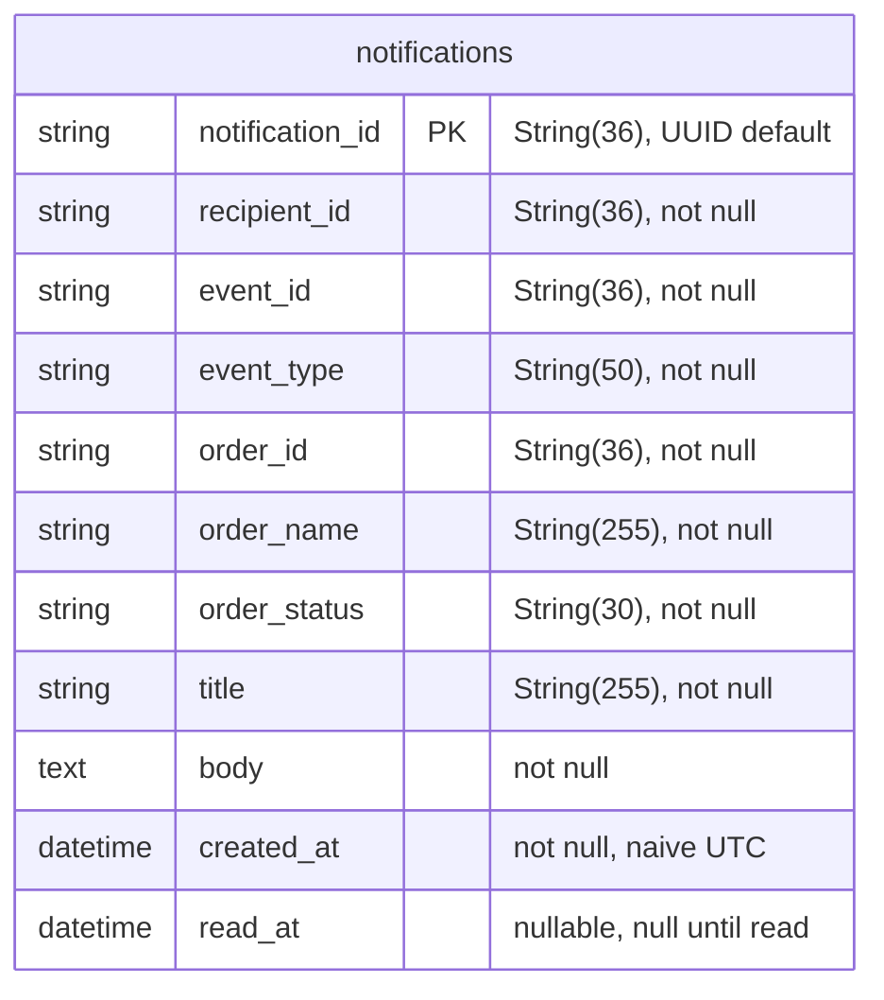

# Notification Service data model

The service owns one PostgreSQL database, `notification-db`, with a single table.
Every column is derived from `app/models/notification.py`.

## Constraints and indexes

- **Primary key** `notification_id`, a UUID assigned on insert.
- **Unique constraint** `uq_notifications_event_recipient` on `(event_id, recipient_id)`.
- **Index** `ix_notifications_recipient_created` on `(recipient_id, created_at DESC)`.

## Column notes

- `recipient_id` is the user the notification is for, decided by `build_notifications`, not necessarily the requester.
- `event_id` is the AMQP `message_id`, or a hash of `event_type | order_id | timestamp` when the publisher omits one.
- `order_name` carries the human-readable order name from the event, falling back to `Order <first 8 chars of order_id>` when absent.
- `order_status` is the lifecycle status the notification reflects, for example `ACCEPTED` or `COMPLETED`.
- `created_at` is the event timestamp coerced to naive UTC for the `timezone=False` column.
- `read_at` is null until the recipient marks the notification read.

## Why the unique constraint delivers N1.1

N1.1 requires that no duplicate user-visible notification is produced on redelivery.
A notification is uniquely identified by **which event it came from** and **who it is for**, which is exactly `(event_id, recipient_id)`.
Because the consumer derives a stable `event_id` from the message, a redelivered event carries the same pair, and the unique constraint rejects the second insert at the database.
The repository performs each insert inside a savepoint and swallows the resulting `IntegrityError`, so the duplicate is dropped silently while every other recipient of the same event still persists.
The guarantee lives in the schema, not in application timing, so it holds under concurrent consumers and retries.

## Listing performance

The read API lists a recipient's notifications newest first.
`ix_notifications_recipient_created` on `(recipient_id, created_at DESC)` serves that query directly, so both the bell poll and the full notifications page stay index-ordered as the table grows.
