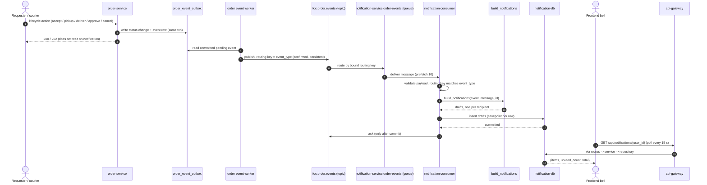
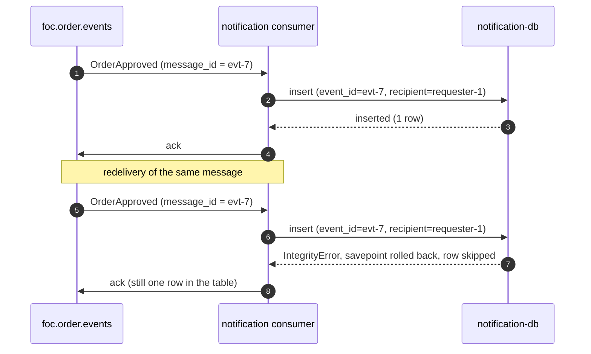

# Notification event flow

Two sequences.
The first follows a single lifecycle action from the requester through to the frontend bell.
The second shows why a redelivered event cannot produce a duplicate notification.

## End-to-end: order event to notification to bell

The publish path uses Order Service's transactional outbox, so the event is written in the same transaction as the order status change and relayed afterwards by a background worker.
Notification Service consumes the event, builds drafts, commits them, and acknowledges only after the commit.
The frontend then reads the notifications back on its next poll.

The requester's HTTP response returns as soon as Order Service commits its own transaction.
Notification delivery happens entirely downstream of that response, so a slow or down notification-service never blocks the order or credit operation (N2.1).

## Duplicate redelivery is dropped

An at-least-once broker can redeliver the same message, for example after a consumer restart before the ack was recorded.
Both deliveries carry the same `message_id`, so the consumer derives the same `event_id` and the unique constraint keeps exactly one row per recipient.

The second insert hits the unique `(event_id, recipient_id)` index, raises `IntegrityError`, and is swallowed by the per-row savepoint.
The message is still acknowledged, so it leaves the queue cleanly, and the table still holds a single notification for that recipient.
