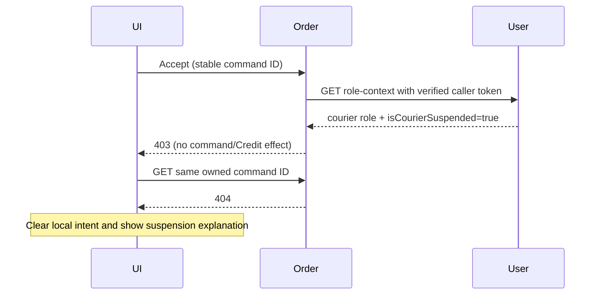

# CHANGE-179 - Role context and suspended courier acceptance

Date: 2026-11-04. Owner: Yao Xiang on `hfix/suspended-courier-acceptance`.

## Authority and approved scope

User approved retaining courier role, consuming User's new `isCourierSuspended` role-context flag, checking it only for new ACCEPT, allowing existing assigned work, and fixing misleading browser pending state. Inspected UserRoleContext/getRoleContext and temporary/permanent suspension: flag exists, roles are retained, inactive accounts receive no roles. Earlier interrupted implementation was discarded; this change uses the newly approved contract. User backend remains read-only.

## Design and pre-coding gate

- Existing authenticated `GET /api/users/role-context` returns `{userId,roles,isCourierSuspended}`. Exact subject binding and current recognized roles remain mandatory. Same request reuses verified context; later requests fetch again. Missing/null flag is unknown and fails new acceptance closed, not silently false. Existing work does not need the flag.
- RoleProvider supplies immutable roles plus optional suspension context to the JWT converter. Verified suspension is carried as a separate authority, never a role or unverified JWT claim. HTTP adapter keeps `verifyCourier` as identity/role only and adds an acceptance-specific guard. Mock mode explicitly remains nonsuspended. No widened controller authorization or removal of existing role annotations.
- ACCEPT checks suspension before journal registration/Credit and before new assignment. Existing START/PICKUP/DELIVER/ABORT, courier history/reporting/read rules keep role/ownership/status/version/hold checks. A saved successful acceptance is replayable without asking permission for a new task.
- Initial suspended acceptance returns403 with a clear explanation. Browser reconciles the same owned command ID: only404 permits clearing a rejected local intent. Saved pending/terminal results are honored;401 and uncertain reads keep recovery and stable IDs.
- A saved no-effect ACCEPT denied on authorized recovery becomes terminal REJECTED. A possible Credit effect must be confirmed reversed/fenced before rejection; existing compensation-policy journal/outbox remains authoritative. Do not clear real unresolved journal rows merely because the courier is suspended.
- No schema/migration, topic, environment/deployment setting, new peer endpoint or sibling implementation. Existing synchronous role lookup and durable Credit recovery are reused; no new broker interaction.

## Responsibilities and sequence

User role-context -> HttpUserServiceRoleProvider -> FirebaseRoleAuthoritiesConverter -> verified courier role/status -> HttpPeerAdapters -> OrderCommandService / OrderAssignmentService. Existing domain locks and transitions still own the Order state. Frontend useOrderCommand owns only browser intent/reconciliation, with existing toast callback for rejection.

## Acceptance and verification

Traceability: user-approved suspension invariant refines existing F3/F4 courier acceptance/delivery; NFR3.1.1 coverage, NFR3.1.3 positive/negative cases. Tests must cover active acceptance, suspended refusal/no journal/Credit, successful replay, existing assigned progression, foreign actor/stale/hold rejection, missing flag/identity/unavailable User response, one role lookup per authenticated request, fresh status on later requests, saved no-effect versus uncertain-effect recovery, and browser403 versus401/status404/pending/unavailable. Existing API shapes and endpoint role guards remain. TDD and final verification in progress; see active-work for results.

## Final verification

Final automated verification: root wrapper -pl order-service -am verify passes701 Order +13 common tests, zero failures/errors/skips, packaging/OpenAPI and coverage gates. Order coverage: branch81.28%, line94.63%. All321 frontend tests and lint pass; both Order/frontend Docker images build successfully, including frontend TypeScript. TOML/whitespace checks pass. Backend first RED:3 expected failures (discarded suspension and old eligibility call); frontend first RED:2 expected false-pending failures. Initial focused DB run was blocked by stopped Docker and malformed PATH; started Docker and removed only that entry in test-process PATH. DB rerun found one DTO-reference-equality fixture assertion; corrected to compare complete serialized saved responses, then full scoped verify passed. An initial unscoped reactor run was stopped after discovering User is now a root module; final evidence is the scoped Order/common run. Existing delayed Surefire fork-shutdown diagnostic appears but final verification exits0 and all coverage checks pass. No sibling backend source, shared config, environment, migration, topic, cloud resource or Git publication changed. Built images only; local application stack was not started. User browser/staging confirmation and deployment of the updated User role-context remain operational checks. Logs: target/change179-backend-red.log, change179-ui-red.log, change179-backend-focused.log, change179-recovery.log, change179-scoped-verify.log, change179-ui-focused.log, change179-frontend.log, change179-lint.log and change179-build.log.

| Requirement | Evidence | Result |
| --- | --- | --- |
| Suspended new acceptance fails promptly | Both accept MVC routes403; no command/Credit; Order remains cancellable | Pass |
| Existing assigned work continues, including during hold | MVC START/PICKUP/DELIVER; foreign courier403; completion hold retained | Pass |
| Authoritative role context, no duplicated ordinary request lookup | Adapter/converter subject binding, flag true/false/missing/null, one lookup and later-request refresh | Pass |
| Idempotency and safe recovery | Successful acceptance replay; RETRY/COMPENSATE no-effect rejection; uncertain reversal false/throw/success; post-Credit barrier reread | Pass |
| Useful browser refusal without losing uncertain work | Forbidden POST + owned404 clears frozen key and shows message; pending/unavailable retained; existing401/polling regressions | Pass |
| NFR3.1.1 / NFR3.1.3 | Full tests and coverage gates; positive/negative/security cases | Pass |

Affected artifacts: Changed requirement amendment/traceability, API integration documentation, security design/ADR and sequence, internal role-context model, Order/frontend application source, tests, documentation/indexes/learning and AI disclosure. Unchanged Order persistence/data schema, endpoint paths/bodies, financial lifecycle/penalty rules, development workflow/skills, deployment/persistence/infrastructure settings and peer backend source. Frontend impact is USER Courier feedback/recovery only; existing shared hook behavior remains covered by the full suite, with no layout/responsive CSS change. Human source review, running authenticated browser and cloud rollout are not claimed as completed.
