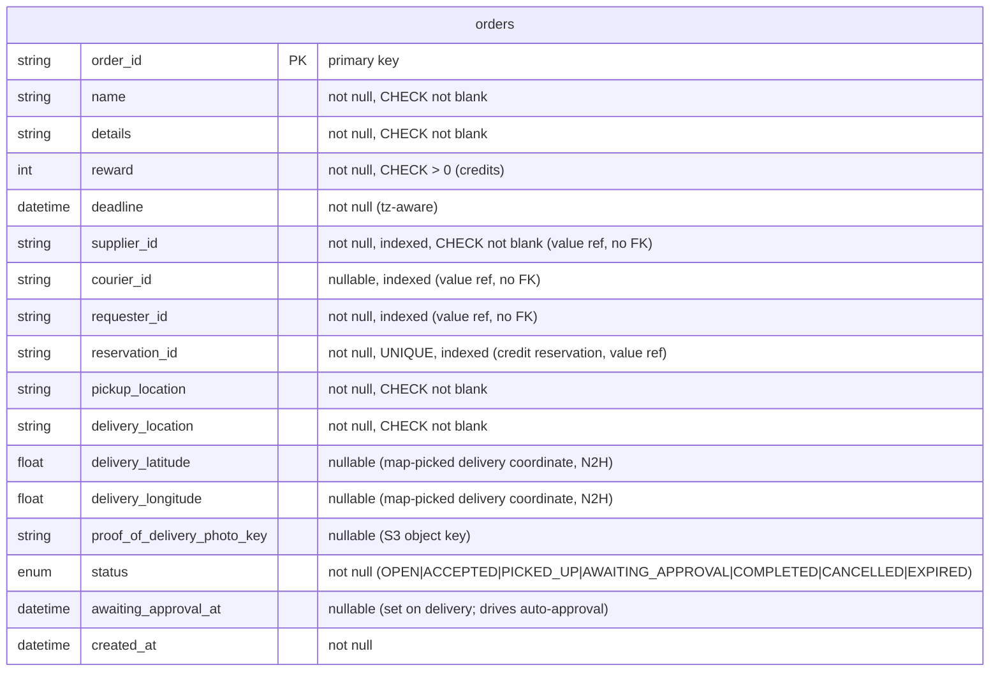

# order-service Data Model

Data model of **order-service** only. For how this service fits among the
others, see the repo-root [`docs/architecture.md`](../../docs/architecture.md);
for the component view and the full table list see
[`architecture.md`](./architecture.md), and for the lifecycle see
[`order-state-machine.svg`](./order-state-machine.svg).

## Entity-relationship diagram (`orders`)

`orders` is the single domain table. Columns are taken directly from
`app/models/orders.py`. `order-db` is owned by this service; other services
never read it (DB-per-service).

Partial indexes: `ix_orders_open_deadline` on `(deadline, order_id)` where
`status = 'OPEN'` (expiry sweep) and `ix_orders_awaiting_approval_at` on
`(awaiting_approval_at, order_id)` where `status = 'AWAITING_APPROVAL'`
(auto-approval sweep).

## Supporting tables

Besides `orders`, `order-db` holds operational tables that make the saga
idempotent and crash-safe. They carry no domain data of their own; details are
in [`architecture.md`](./architecture.md).

| Table | Purpose |
| --- | --- |
| `order_requests` | Idempotent withdrawal requests keyed by `Idempotency-Key`. |
| `order_release_tasks`, `order_update_tasks`, `order_approval_tasks` | Pending credit tasks correlated to `foc.credit.events` replies by `task_id`. |
| `order_event_outbox` | Transactional outbox; the relay publishes committed facts to `foc.order.events`. |
| `supplier_deactivation_inbox` | Dedupe record of consumed `SupplierDeactivated` events for redelivery safety. |

## Explained elements

- **No cross-database foreign keys.** `supplier_id`, `requester_id`,
  `courier_id`, and `reservation_id` are ids owned by other services,
  referenced by value and validated over HTTP or events, never by a cross-DB FK.
- **`reservation_id` is unique.** Each order maps to exactly one credit
  reservation, which keeps completion and cancellation handling idempotent.
- **Status is a DB enum.** The seven values match `OrderStatus`
  (`app/services/lifecycle.py`); invalid transitions are rejected in code, not
  stored. See the state machine diagram.
- **Proof of delivery.** `proof_of_delivery_photo_key` holds the key of a photo
  stored in a private S3 bucket via `foc_shared.images`, not the image bytes.
