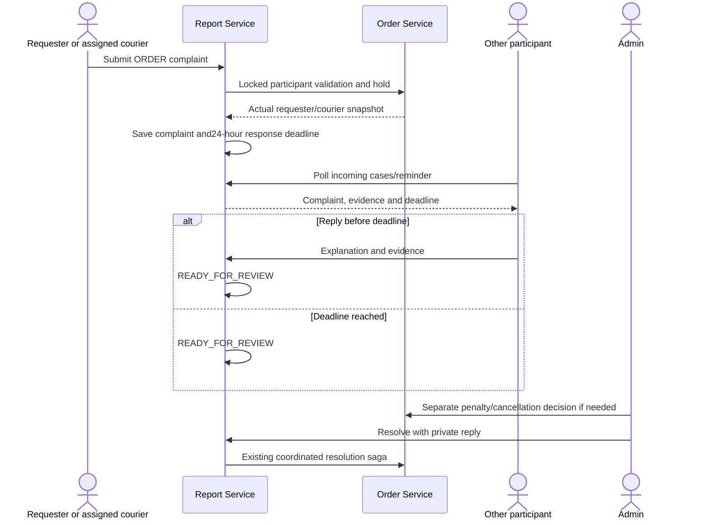

# ADR-065 — Unified Order reports and opposite-party responses

2026-11-02. Approved by Yao Xiang. Supersedes ADR-064's separate ERRAND category and direct admin review for courier complaints. See CHANGE-174.

Both participants submit ORDER; GENERAL remains unlinked. The actual other participant receives the report under Against me and gets the response reminder. A response with optional evidence, or the24-hour deadline, sends the case to admin review. No timeout cancels an Order or applies penalties. Admins retain early resolution with a warning. Admin private replies remain submitter/admin only.

Report stores actual requesterId and courierId separately from reporterId. respondentId is derived from those authoritative saved identities, never from client-supplied recipient fields. Preserve the compatibility wire status AWAITING_COURIER_RESPONSE and response field courierResponse; new additive responseExplanation and respondentId explain their generic meaning. UI says Awaiting response and Response. No new enum status, SQL migration or topic.

Order GET /api/orders/mine/active?mode=participant performs the owned/currently-assigned union and status filtering in SQL before pagination. Hold PUT accepts reporterRole=PARTICIPANT, locks the participant-scoped row, then requires the actual participant's verified role/subject; existing defaults remain compatible. Pending-command, one-active-report and hold funding guards remain. Current delivery progression continues.

The existing scheduler upgrades bounded legacy ERRAND batches transactionally; a rotating document cursor ensures resolved history cannot starve later unresolved cases. Reads also reconcile relevant records. Upgrade changes category once and grants a fresh24-hour window. No resolved history changes. Existing SQL holds remain. Saga resolution normalizes the legacy record before capturing its rollback preimage, so compensation preserves the upgrade and deadline rather than extending it. Revision fences still protect later work.

Single-field Firestore participant queries scope reads before respondent filtering; no new composite index or GCP provisioning. Participant pages/counts currently read that participant's report set, an existing scale trade-off improved from collection-wide reads. No new messaging, financial policy, User/Credit/Supplier implementation or scheduler is introduced. Durable existing compensation remains necessary for uncertain cross-service commits.

Testing/verification: reversed ownership and response authorization, one-time migration, resolved history, deadline boundary, notification privacy, SQL scoping, hold rules, synchronous resolution/replay and durable Pub/Sub compensation. Results in CHANGE-174.
