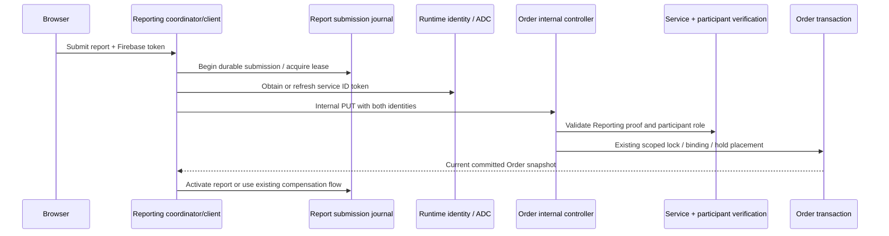
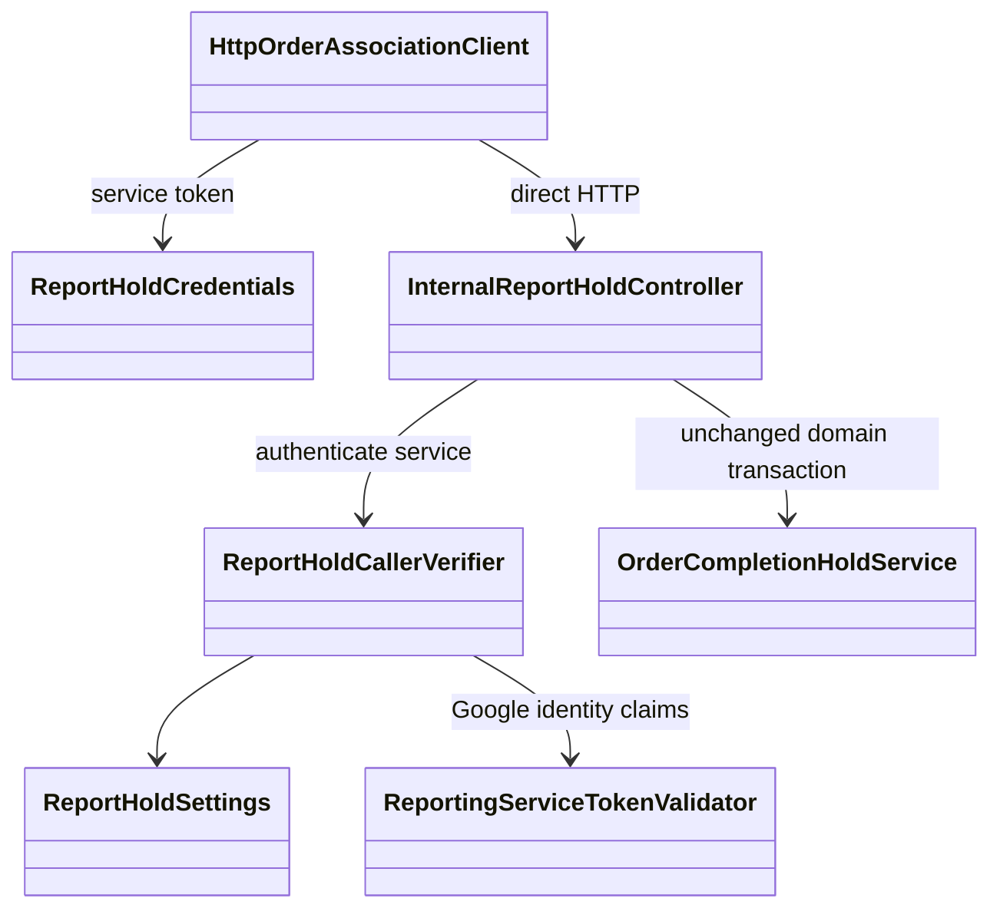

# Reporting-authenticated Order hold placement

CHANGE-189 / ADR-071, approved Yao Xiang, 2026-11-11. This replaces only the public
placement mutation. The browser still creates reports through Reporting and queries
its eligible Orders through GET /api/orders/mine/active.

## Contract

```http
PUT /api/orders/internal/report-holds/{orderId}/{reportId}
Authorization: Bearer <participant Firebase token>
X-Reporting-Service-Authorization: Bearer <Reporting Google ID token>
X-Serverless-Authorization: Bearer <same Reporting Google ID token>
Content-Type: application/json

{"requireAssignedCourier":true,"reporterRole":"REQUESTER","submissionId":"11111111-1111-4111-8111-111111111111"}
```

reporterRole is REQUESTER, COURIER or PARTICIPANT. IDs, body validation, eligibility,
binding, locks/idempotency and six response fields remain unchanged:
id, requesterId, courierId, status, reportId, isCompletionHold. Identity comes from
the Firebase principal, never from an input user ID. Existing held funding/delivery
rules and creation/resolution compensation remain unchanged.

The old PUT /api/orders/mine/active/{orderId}/report-holds/{reportId} is removed,
with no fallback/redirect. Gateway blocks /api/orders/internal/...; Reporting must
use its configured direct Order backend URL. A service identity alone is insufficient:
the authenticated participant must still own/be assigned to the eligible Order.

200 means committed/reused hold; 400 invalid payload; 401 missing/invalid participant
or service proof; 403 mismatched participant role; 404 unrelated/missing/ineligible
Order; 409 hold/submission/command conflict; 503 disabled feature, missing cloud auth
configuration or temporarily unavailable identity/role verification.

## Cloud identity and configuration

Order verifies the signed Google token with Google's OAuth2 JWKs, timestamp validator,
Google issuer, exact audience, verified email of the configured Reporting runtime
account, nonblank subject and required issue/expiry claims. Signature/identity failures
fail closed. Transient JWK verification failure returns503, not successful placement.
The separate application header retains the signed token; Cloud Run may process the
X-Serverless header before the application receives the request.

Order deploy settings:

- ORDER_REPORT_HOLD_AUTH_MODE=google
- ORDER_REPORT_HOLD_AUDIENCE=${ORDER_SERVICE_URL}
- ORDER_REPORT_HOLD_CALLER_SERVICE_ACCOUNT=foc-reporting-service@${PROJECT_ID}.iam.gserviceaccount.com

Reporting deploy settings:

- REPORT_ORDER_HOLD_AUTH_MODE=google
- REPORT_ORDER_HOLD_AUDIENCE=${ORDER_SERVICE_URL}

ReportHoldCredentials obtains an ID token from the attached runtime identity using
Application Default Credentials; cached credentials refresh before expiry. No JSON
key is added, no new service account/topic is created. Scoped
infra/gcp/configure-report-pubsub.sh <environment> wire grants the existing Reporting
runtime roles/run.invoker on Order for authenticated Cloud Run ingress. It retains
existing saga wiring. The coding task does not execute it against GCP.

Google's primary guidance: [Cloud Run service-to-service authentication](https://docs.cloud.google.com/run/docs/authenticating/service-to-service).

## Local emulators

Both Compose variants inherit explicit local modes and the same
REPORT_HOLD_LOCAL_CREDENTIAL (a development-only default can be overridden in .env).
Reporting sends Local <credential> in the service header; Order compares it using a
constant-time comparison. This fixture is not production authentication. Both sides
reject local mode outside FOC_ENVIRONMENT=local, a demo-* auth project and configured
Firebase emulator, or when the credential is too short. Cloud mode never accepts it.
It is not exposed to the browser. The Firebase participant token is still required.

Do not submit reports during a two-service rebuild:

```powershell
docker compose -f compose.yaml -f compose.http-peers.yaml up -d --build --no-deps order-service reporting-service
docker compose -f compose.yaml -f compose.http-peers.yaml ps order-service reporting-service
```

Wait for both to be healthy. This task validated Compose but did not rebuild/restart
the user's running application or mutate existing reports/holds.

## Responsibilities and flow





## Rollout, rollback and limits

Pause linked report submissions while deploying both compatible versions. Configure
matching audiences and the existing runtime account; wire scoped IAM and verify both
service/user denial cases, then resume. Old Reporting clients cannot use the removed
public URL. Do not solve rollback by restoring public untrusted placement: coordinate
both binaries/settings while submissions are paused. Existing journals and holds are
retained; no migration, event conversion or sequence reset is needed.

This closes the reviewed direct-participant hold bypass. It does not prove every
trusted Reporting call is bug-free and does not fix the separate stale-upload failure
race recorded in CHANGE-187. No new report lookup callback or synchronous dependency
from Order to Reporting is introduced during placement.

Verification results and limitations: CHANGE-189. Local signed-token/claim checks and
mocked ADC/HTTP tests do not verify deployed Google credentials/IAM; cloud smoke tests
remain an operator step.
