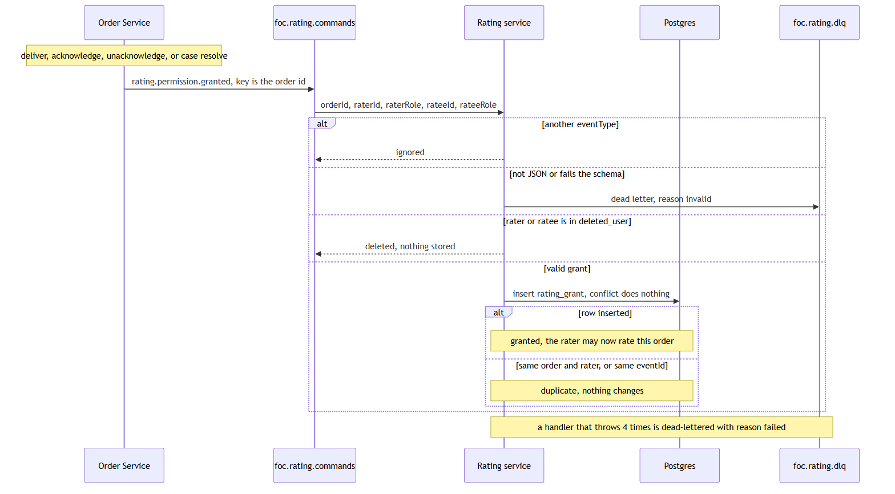
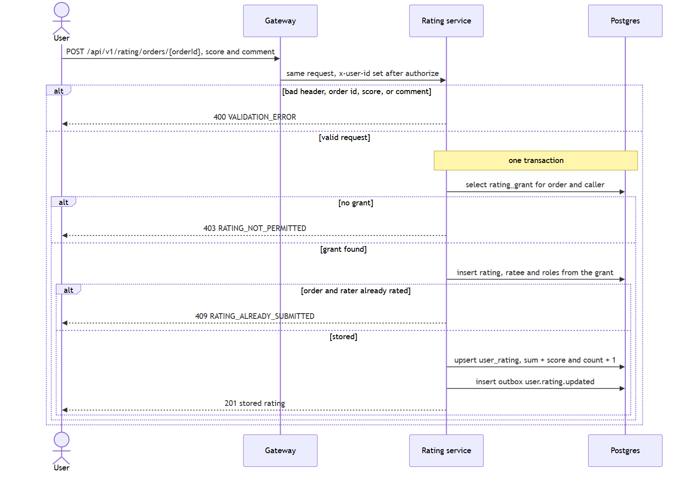
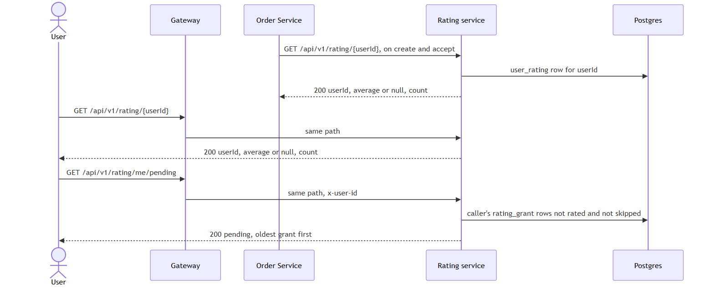
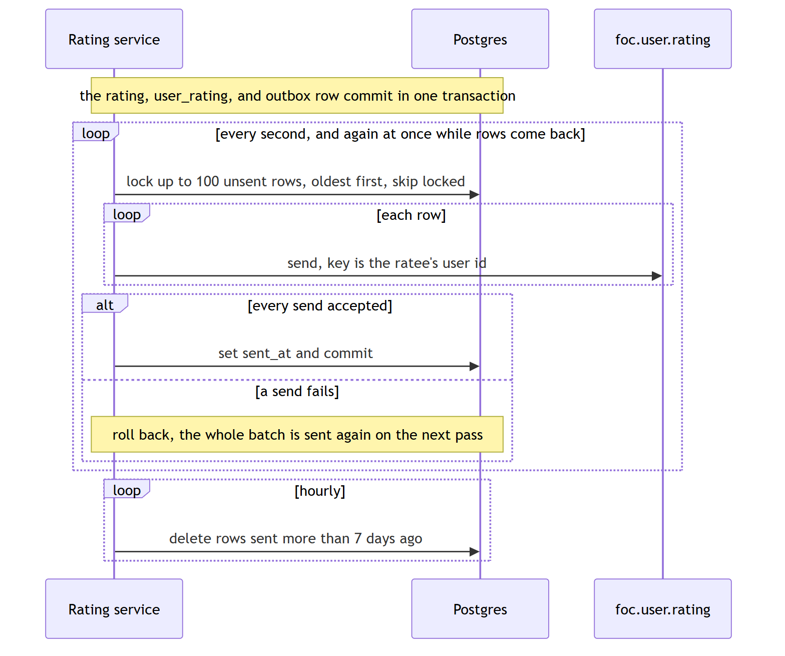
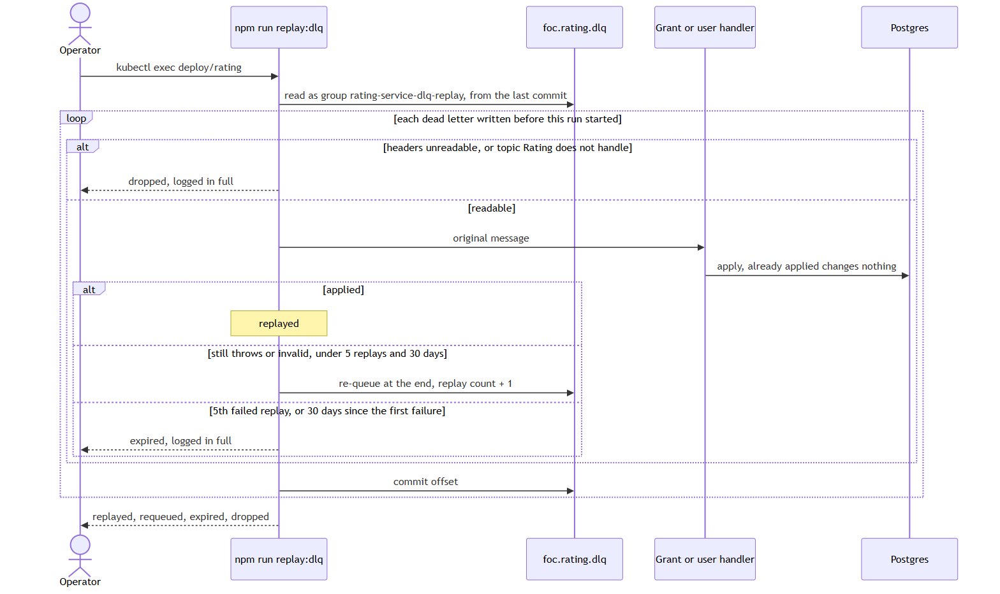
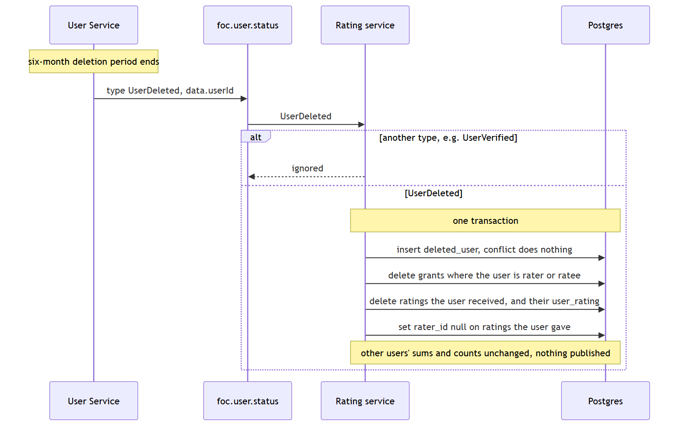

# Sequence diagrams

Each diagram is the interaction as the service implements it. Table shapes are in [schema.md](schema.md). Routes, headers, and event fields are in [interfaces.md](interfaces.md). The Mermaid source for each picture is the `.mmd` file of the same name.

Order Service decides who may rate whom; Rating only accepts a rating it has been told to expect. A submitted rating commits the rating row, the user's running total, and the Kafka outbox together. The broker publish happens afterwards, on the outbox relay.

## Grants from Order

Each `rating.permission.granted` becomes one `rating_grant` row: this rater may rate this ratee for this order. The primary key `(order_id, rater_id)` and the unique `event_id` make a redelivered or repeated grant a no-op. Rating does not check order states itself; that rule belongs to Order, and only Order may write to `foc.rating.commands`. A grant that names a deleted account as rater or ratee is ignored (see [Account deletion](#account-deletion)).

When Order sends a grant (Order's [interfaces.md](../../order-service/docs/interfaces.md#kafka)):

| Order event | Rater → ratee |
| --- | --- |
| Deliver | courier → requester |
| Acknowledge, or the acknowledgement window ends (unacknowledged) | requester → courier |
| Admin resolves the case, any verdict | requester → courier |
| Admin resolves the case as `requester` at fault or `no-fault` | courier → requester |

Order never withdraws a grant; only account deletion removes one. A courier who got a grant on delivery keeps it even if a later dispute finds them at fault. When a resolution grants the courier again, the second grant has the same order and rater and is ignored, so there is still at most one rating each way per order.

## Submit a rating

The rater is the gateway's `x-user-id`, never a body field. The ratee and both roles come from the grant, so a caller can only rate the person Order paired them with. The unique `(order_id, rater_id)` on `rating` turns a second submit, including a double click, into 409. The score is checked twice: 1 to 5 in the request schema, and by a check constraint in the database.

The running total is one upsert that adds to the stored sum and count rather than reading them and writing them back, so two ratings for the same user at the same moment cannot lose an update. If any step fails, the transaction rolls back and nothing is stored or queued.

A grant that has been used is a rating. Unused grants are what `GET /me/pending` lists, oldest first, for the frontend's rating prompt. "Skip" in the prompt calls `POST /orders/{orderId}/skip`, which sets `skipped_at` so the grant stops appearing on every device. It checks the same things as submitting (403 without a grant, 409 if already rated), and the grant stays valid, so the order can still be rated later.

## Reads

`GET /{userId}` is the unified average over every rating the user has received, in either role, rounded to 2 decimal places. It is null with a count of 0 for a user nobody has rated, so a caller never mistakes "no ratings" for a 0-star average. Order reads it over the mesh when an order is created (requester) and accepted (courier) and stores it on the order as a snapshot. Signed-in users read it through the gateway.

## Outbox publish

The relay locks unsent rows with `FOR UPDATE SKIP LOCKED`, so several replicas can relay without sending a row twice. If a send fails, the batch's transaction rolls back and every row in it is sent again on the next pass. Delivery is therefore at least once. `user.rating.updated` carries the user's whole average and count, so a consumer can ignore any message whose count is not higher than what it has; Badges does exactly that.

A separate timer deletes rows sent more than 7 days ago (`OUTBOX_RETENTION_HOURS`, Kafka's default retention), hourly by default, so the table does not grow forever. Unsent rows are never deleted.

## Failure handling

| Failure | Result |
| --- | --- |
| Grant is not JSON, or fails the schema | Logged as invalid, sent to `foc.rating.dlq`, and skipped |
| Message has another `eventType` | Ignored |
| Grant handler throws, e.g. the database is down | Retried up to 4 attempts, waiting 200 ms × attempt between them, then logged, sent to `foc.rating.dlq`, and skipped so the partition keeps moving. `npm run replay:dlq` applies it once the cause is fixed. If Kafka refuses the dead letter, the message is retried instead of lost |
| Kafka unavailable when publishing | Outbox rows wait and are sent on a later pass |
| No `KAFKA_BROKERS` | HTTP only. No grants arrive and outbox rows wait |

## Dead letters and replay

A consumed message the consumer gives up on goes to `foc.rating.dlq` with its origin, reason, replay count and first failure time in headers (field list in [interfaces.md](interfaces.md#kafka)). The topic keeps it 30 days. `npm run replay:dlq`, run inside the rating pod, runs each dead letter written before the run started through its handler again. Grants and deletions ignore what is already applied, so replaying one that got through in the end changes nothing. A message that still fails is re-queued at the end of the topic; after its 5th failed replay or 30 days it is expired instead, so a message that can never succeed does not circle forever. Expired and dropped messages are written in full to the replay's error output so they can be applied by hand. The script exits non-zero when anything was re-queued.

## Account deletion

User publishes `UserDeleted` on `foc.user.status` once an account's six-month deletion period ends (User F5), in its own envelope (`type`, `data.userId`). Rating removes the user's grants as rater or ratee, the ratings they received and their running total, and sets `rater_id` to null on the ratings they gave, all in one transaction. Other users' sums and counts don't change, so nothing is published and Badges' view of them stays right. The user is recorded in `deleted_user`; a grant that later names them as rater or ratee is ignored, so a replay can't recreate their data. A repeated `UserDeleted` is a no-op.

## Consistency

Each grant and each rating is one local PostgreSQL transaction. Across services the system is eventually consistent: Order commits the order change and its grant in its own outbox, Rating stores the grant a moment later, and Badges sees the new average a moment after the rating commits. Nothing spans the services in a single transaction; the outboxes on both sides and idempotent consumers make the hand-offs reliable.
