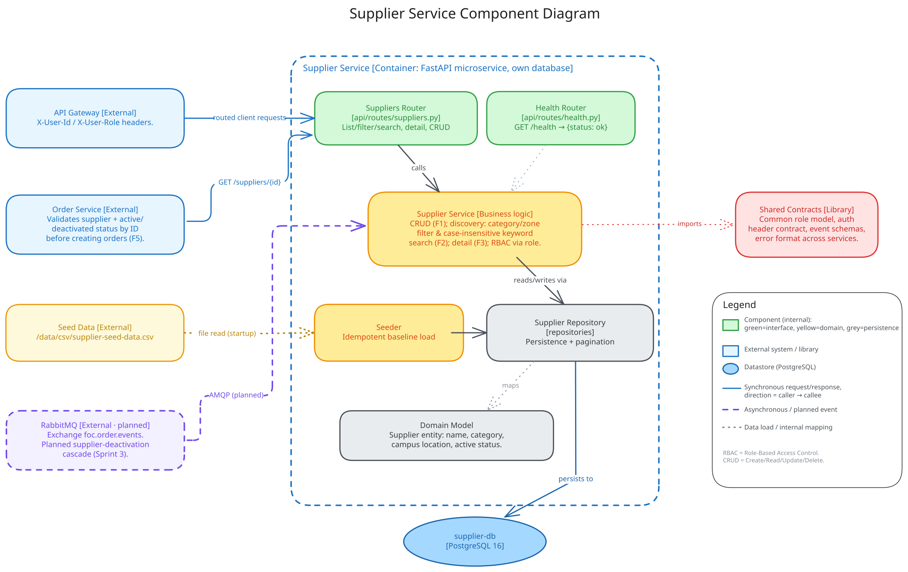

# supplier-service architecture

Describes the **current repository**. The supplier-service maintains the campus
supplier catalog and exposes discovery, detail, and validation APIs. See also
[`data-model.md`](./data-model.md), [`api-contract.md`](./api-contract.md), and
the repo-root [`docs/architecture.md`](../../docs/architecture.md).

## Component architecture (C4 level 3)

The diagram above is the authoritative component view (PNG fallback:
[`supplier-service-architecture.png`](./supplier-service-architecture.png)).

## Components and responsibilities

| Component | Responsibility |
| --- | --- |
| `app/main.py` | App wiring and lifespan (`init_db`, idempotent seed). |
| `app/api/routes/suppliers.py`, `health.py` | Discovery (list, filter, search), detail by id, admin CRUD, and the service-to-service validation endpoint. |
| `app/api/deps.py` | `require_admin` RBAC from gateway-injected identity; dependency injection. |
| `app/services/supplier_service.py` | Discovery, detail, and CRUD business logic. |
| `app/services/seeder.py` | Idempotent load of the baseline catalog from the mounted seed CSV (F4). |
| `app/services/event_worker.py` | Relay that publishes committed `SupplierEventOutbox` rows to `foc.supplier.events` and retries failures. |
| `app/repositories/supplier_repo.py`, `supplier_event_outbox.py` | Persistence over the `suppliers` table and the transactional event outbox. |
| `app/models/supplier.py` | `Supplier` ORM model. See [`data-model.md`](./data-model.md). |

## External relationships

| Direction | Protocol | Meaning |
| --- | --- | --- |
| Gateway -> Supplier API | HTTP JSON, gateway-injected identity | Client discovery/detail; admin CRUD restricted by `require_admin`. |
| Order -> Supplier | HTTP `GET /suppliers/{id}`, `GET /suppliers` | Validate a supplier on order creation; resolve ids for category filtering. |
| Seed CSV | read-only mount at `/data/csv/` | One-time idempotent catalog load on startup. |
| Supplier -> `foc.supplier.events` | AMQP via transactional outbox | On deactivation, publishes a `SupplierDeactivated` fact. |

Supplier owns `supplier-db` and never reads another service's data. Order
Service consumes `SupplierDeactivated` and independently cancels affected
pre-pickup (`OPEN` / `ACCEPTED`) orders; Order owns that cascade.
