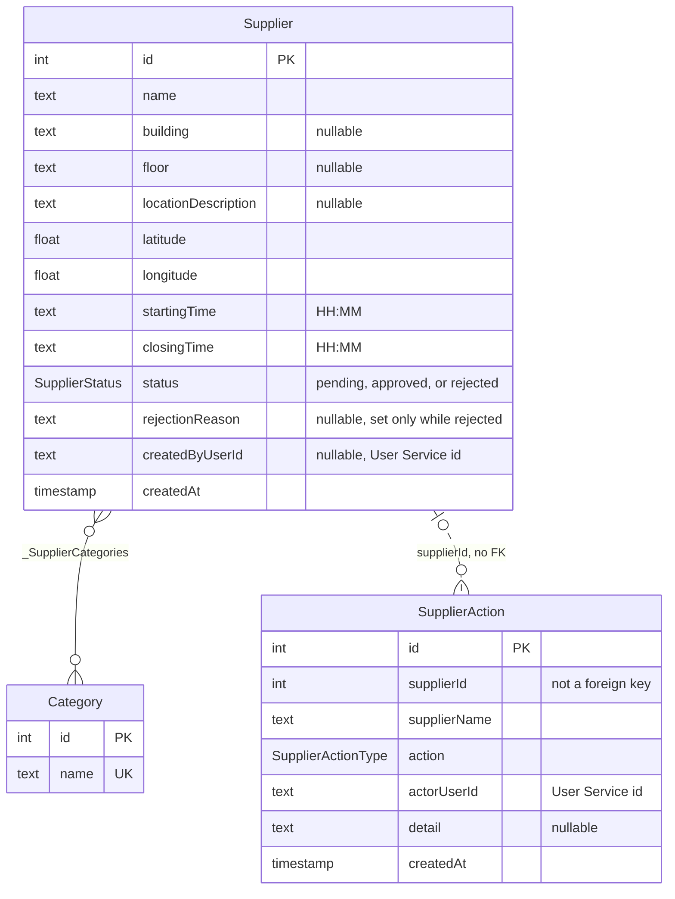
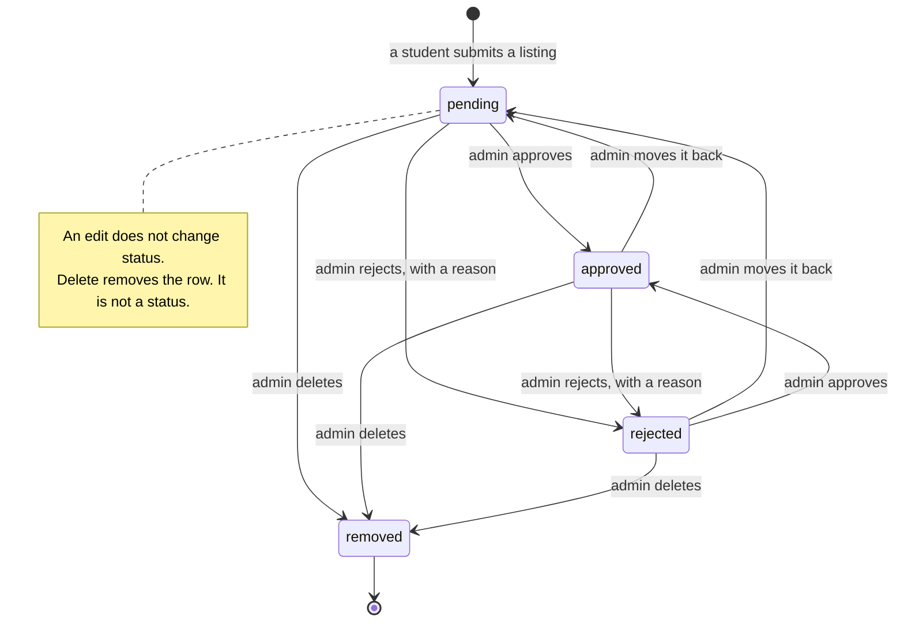

<!--
AI Assistance Disclosure
Tool: Cursor (Auto), date: 2026-11-10
Scope: Documentation wording for Supplier Service under author-fixed design.
Author review: Sahana Avantika generated ideas, designed implementation, validated correctness, edited where needed, and verified behavior/tests.
-->
# Supplier Service — Database Schema

**Datastore:** PostgreSQL · **Model:** one listing, a many-to-many category, and an audit row that outlives a deleted listing

The Supplier Service stores campus pickup listings for Friend on Campus (FoC).
A permitted user submits one. A verified admin edits, approves, rejects, or
deletes it. The public catalogue is approved listings only. Order Service
reads one listing by id and accepts it as a pickup only when `status` is
`approved`.

The executable schema is `prisma/schema.prisma`. Migrations, in order:
`20260922104617_init` → `20260923045627_add_categories` →
`20261020125100_supplier_actor_audit` → `20261103120000_supplier_rejection_reason`.
Postgres identifiers stay camelCase, as Prisma created them.

## Design decisions

- **PostgreSQL.** One transaction creates or updates the listing and inserts its `SupplierAction` row.
- **This service does not own users or orders.** `createdByUserId` and `actorUserId` are User Service ids stored as `TEXT`. There is no foreign key to that database.
- **`SupplierAction` is not a foreign key to `Supplier`.** The row keeps `supplierId` and `supplierName` after the listing is deleted, so a removal still names who did it and which stall it was.
- **Categories are shared.** A name is unique. Creating or editing a listing connects existing names and creates the missing ones. Deleting a listing removes its join rows. The `Category` row stays, even if no listing uses it.
- **`rejectionReason` is set only while `status` is `rejected`.** Approving the listing, or moving it back to `pending`, stores `null`. The public catalogue does not include the reason, because that list is approved-only. The admin list and `GET /api/v1/supplier/{id}` do.
- **Status is not a one-way gate.** An admin can set `pending`, `approved`, or `rejected` from any current status. `rejected` requires a reason of 1–4000 characters. An edit of the name, place, hours, or categories does not change `status`.
- **The public list is `approved` only.** `GET /api/v1/supplier/{id}` still returns a pending or rejected listing, so Order Service checks `status` itself and refuses anything that is not `approved`.

## Entity–Relationship Diagram



**Reading the diagram**

- The category line is a real foreign key, both ways, through `_SupplierCategories`. Prisma names the columns `A` (category id) and `B` (supplier id). Deleting a supplier deletes those join rows.
- The action line is dashed. `supplierId` is a copy of the listing id, not a foreign key, so the audit row remains after delete.

## Tables

### `Supplier` — one campus listing

| Column | Type | Constraints | Notes |
|---|---|---|---|
| `id` | `SERIAL` | **PK** | Integer. Order stores this id as the pickup location id. |
| `name` | `TEXT` | `NOT NULL` | Not unique. |
| `building` | `TEXT` | `NULL` | |
| `floor` | `TEXT` | `NULL` | |
| `locationDescription` | `TEXT` | `NULL` | |
| `latitude` | `DOUBLE PRECISION` | `NOT NULL` | App rejects a value outside `-90`–`90`. No database `CHECK`. |
| `longitude` | `DOUBLE PRECISION` | `NOT NULL` | App rejects a value outside `-180`–`180`. |
| `startingTime` | `TEXT` | `NOT NULL` | `HH:MM`, 24-hour. Must differ from `closingTime`. |
| `closingTime` | `TEXT` | `NOT NULL` | `00:00` and `23:59` is the all-day pair. |
| `status` | `SupplierStatus` | `NOT NULL`, default `pending`, index `Supplier_status_idx` | `pending`, `approved`, `rejected`. |
| `rejectionReason` | `TEXT` | `NULL` | Added in `20261103120000_supplier_rejection_reason`. |
| `createdByUserId` | `TEXT` | `NULL` | Caller on create. Older rows from before `20261020125100_supplier_actor_audit` are null. |
| `createdAt` | `TIMESTAMP(3)` | `NOT NULL`, default `CURRENT_TIMESTAMP` | |

The original `type` column was dropped in `20260923045627_add_categories`. Categories replaced it.

```
pending  →  approved
         →  rejected   (reason required)
approved →  pending    (reason cleared)
         →  rejected
rejected →  pending    (reason cleared)
         →  approved   (reason cleared)
```

Delete removes the row. It is not a status. An edit of the name, place, hours, or categories does not change `status`.

Source: [status-diagram.mmd](status-diagram.mmd). Rendered figure: [status-diagram.png](status-diagram.png). Who calls whom is [seq-pickup.mmd](seq-pickup.mmd) ([seq-pickup.png](seq-pickup.png)).



### `Category` — a shared label

| Column | Type | Constraints | Notes |
|---|---|---|---|
| `id` | `SERIAL` | **PK** | |
| `name` | `TEXT` | `NOT NULL`, **unique** `Category_name_key` | Matched exactly. The public filter is OR across the names in `?category=`. |

### `_SupplierCategories` — listing to category

| Column | Type | Constraints | Notes |
|---|---|---|---|
| `A` | `INTEGER` | **FK** → `Category.id`, `ON DELETE CASCADE` | |
| `B` | `INTEGER` | **FK** → `Supplier.id`, `ON DELETE CASCADE` | |
| | | **unique** (`A`, `B`) | Index `_SupplierCategories_B_index` on `B`. |

An edit replaces the whole set. It does not append.

### `SupplierAction` — who changed a listing

One row per create, edit, approve, reject, move back to pending, and delete. Inserts happen in the same transaction as the listing change. There is no update or delete of these rows in the application. The database does not enforce append-only the way Admin Service does for `audit_logs`.

| Column | Type | Constraints | Notes |
|---|---|---|---|
| `id` | `SERIAL` | **PK** | |
| `supplierId` | `INTEGER` | `NOT NULL`, index `SupplierAction_supplierId_idx` | Not a foreign key. |
| `supplierName` | `TEXT` | `NOT NULL` | Name at the time of the action. |
| `action` | `SupplierActionType` | `NOT NULL` | `created`, `edited`, `approved`, `rejected`, `pending`, `deleted`. |
| `actorUserId` | `TEXT` | `NOT NULL`, index `SupplierAction_actorUserId_idx` | The signed-in caller. |
| `detail` | `TEXT` | `NULL` | Edit: the field names changed, comma-separated. Reject: the reason. Otherwise null. |
| `createdAt` | `TIMESTAMP(3)` | `NOT NULL`, default `CURRENT_TIMESTAMP` | |

`GET /api/v1/supplier/admin/activity` returns the newest 100 rows, optionally for one `supplierId`.

## Transaction boundaries

There is no Kafka and no outbox.

| Flow | The transaction does |
|---|---|
| Create | `INSERT Supplier` (status `pending`) and `INSERT SupplierAction` (`created`). Categories are connected or created in that write. |
| Edit | `UPDATE` the listing fields only, then `INSERT SupplierAction` (`edited`) with the changed field names in `detail`. Status and `rejectionReason` stay as they were. |
| Set status | `UPDATE status` and `rejectionReason`, then `INSERT SupplierAction` (`approved`, `rejected`, or `pending`). |
| Delete | `INSERT SupplierAction` (`deleted`) first, then `DELETE Supplier`. Join rows to categories go with the listing. The action row stays. |
