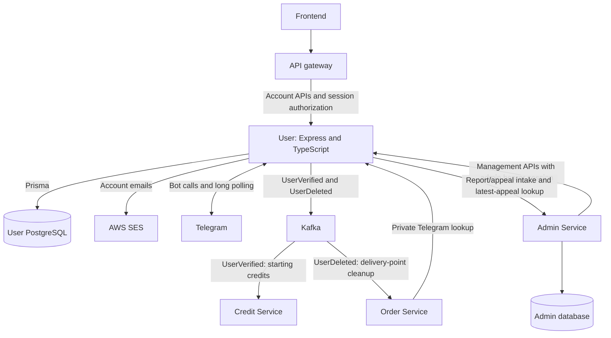

<!--
AI Assistance Disclosure
Tool: OpenAI Codex (GPT-5.6 Luna, GPT-5.6 Sol, GPT-6 Sol and GPT-6.1 Sol), 2026-09-25 to 2026-11-11.
Scope: Documentation wording assistance under author-finalized User Service requirements and architecture.
Author review: Josh Wang Kai Kiat validated correctness, edited where needed, and verified behavior/tests.
-->
# User Service architecture

User Service owns accounts, credentials, sessions, verification, friendships and account lifecycle decisions. For setup, configuration and test commands, use the [README](../README.md); for stored fields, use the [schema guide](schema.md). Exact HTTP/event payloads belong in [OpenAPI](../src/openapi.ts) and [API_CONTRACT_UPDATES.txt](../API_CONTRACT_UPDATES.txt).

## Service boundaries



User accesses only its own database. Admin owns reports, appeals, rejection reasons and review decisions; Credit owns balances and credit history; Order owns delivery points. SES delivers email, while the Telegram bot runs inside User Service. Direct Telegram contact links do not create a chat-storage service.

## Authentication and access

Login issues a random opaque bearer token, not a JWT. Only its SHA-256 hash is stored in `AuthSession`; authentication checks expiry, revocation and current account restrictions. Passwords use salted scrypt, and OTP/reset/challenge records store hashes rather than usable credentials. Keep raw tokens and passwords out of logs.

For protected requests, the gateway calls User's private `/internal/authorize` endpoint and replaces client-supplied identity headers with trusted `x-user-id`, `x-is-admin` and `x-permitted-action`. Receiving services still enforce their own permissions. Public `Created`/`Verified`/`Suspended` status is computed from verification timestamps and `accessStatus`; role, lockout and pending deletion are separate checks.

| Interface | Access boundary |
| --- | --- |
| Gateway session authorization | Real user bearer session; User internal routes are blocked publicly. |
| Order Telegram lookup | Private networking and Order-only mesh route policy; no shared application token. |
| User-side Admin search, role/status changes and rejection notices | Eligible administrator's real bearer session, forwarded by Admin. Identity headers alone are insufficient. |
| Friendships | Active account, real session, neither deletion requested nor scheduled. Active `Created` accounts are allowed; no verification or Order-history check. |
| Reports | Active reporter/session with no pending deletion; existing target before its deletion deadline. Suspended or future-deleting targets remain reportable. |
| Appeals | Correct email/password for a suspended, unlocked account before its deletion deadline; no session issued. |
| User-to-Admin intake and latest lookup | Private route-specific mesh access; Admin trusts User's validation without application-level intake authentication. |

The gateway and frontend nginx block `/api/v1/admin/appeals/latest`; Admin's checked-in mesh rule admits only User there. See [gateway values](../../deploy/charts/foc-gateway/values.yaml), [nginx configuration](../../frontend/nginx.conf) and [Admin values](../../deploy/values/services/admin.yaml). Check that this source configuration is enforced in the target environment.

## Signup and verification

Email and Telegram verification can complete in either order. This sequence shows email first; frontend calls pass through the gateway.

```mermaid
sequenceDiagram
    actor Person
    participant UI as Frontend
    participant U as User Service
    participant DB as PostgreSQL
    participant Mail as SES
    participant TG as Telegram
    participant K as Kafka
    Person->>UI: Sign up with name, email, password and handle
    UI->>U: Sign up
    U->>DB: Save account, password hash and email OTP hash
    U->>Mail: Send OTP
    Mail-->>Person: Email OTP
    UI->>U: Submit email OTP, then log in
    U->>DB: Verify email; save session token hash
    U-->>UI: Raw bearer token
    UI->>U: Request Telegram challenge with bearer token
    U->>DB: Save hashed deep-link token
    U-->>UI: Bot link
    Person->>TG: Open link and press Start
    U->>TG: Poll updates; check sender against registered handle
    U->>DB: Save challenge sender and OTP hash
    U->>TG: Send OTP
    TG-->>Person: Telegram OTP
    UI->>U: Submit Telegram OTP with bearer token
    U->>DB: Atomically save linked identity, verification and outbox
    U->>K: Publish UserVerified; mark published after acknowledgement
    Note over U,K: Retry pending events with stable IDs
```

Credit grants starting credits asynchronously and handles repeated verification delivery. A verified account can therefore precede its credit grant. Failed email delivery may leave an unverified account; resend after fixing delivery. Development loggers and the gated non-production verification override are testing paths. Telegram long polling needs one active poller per bot token.

## Friendship lifecycle

Requests move from `PENDING` to recipient-only `ACCEPTED` or `REJECTED`; removal changes `ACCEPTED` to `REMOVED`. Rejected/removed rows remain history, and a later invitation gets a new request UUID. Matching accept/reject retries return `changed: false` while that resulting state remains current; removal is idempotent and never cancels a pending request. Crossed requests conflict rather than auto-accept.

Mutations lock participant accounts in UUID order and recheck the caller/session inside the transaction. The database rejects self-relations and permits only one `PENDING`/`ACCEPTED` row per unordered pair through custom migration SQL. Suspended/deleting peers are hidden from lists and cannot receive invitations; acceptance requires an available sender even on retries. An available caller may still reject or remove a relationship with an unavailable peer.

Lists return only IDs/names and necessary request metadata, with `Cache-Control: no-store`. Count/page use a repeatable-read transaction, ordered by creation descending then request UUID ascending. Accepted-friend search matches a case-insensitive literal name substring. Exact pagination/search validation and routes are in the contract notes.

## Reports, appeals and suspended login

User validates report/appeal input, rechecks account eligibility under locks, then calls Admin outside those locks without forwarding passwords or tokens. Admin deduplicates open reports per reporter/target and open appeals per user, preserving original text; this is not a lifetime submission limit. User validates UUID-matched camelCase responses and returns only allowed fields. These records add no User model or outbox.

With a correct password before the deletion deadline, suspended login returns `403 ACCOUNT_SUSPENDED` even when `lockedAt` is set. It creates no session and does not clear the lock. Only then does a private latest-appeal lookup run outside database locks: a valid same-user rejected appeal adds its reason to the message. Missing configuration, lookup failure, invalid/mismatched data or other appeal states retain the generic suspension message. Wrong passwords never trigger the lookup. Active locked login and locked appeal submission remain generic `401`; password reset clears lockout.

The Admin client uses bounded timeouts/responses, rejects redirects and does not automatically retry. Intake failures return sanitized errors; lookup failures fall back as above. Appeals also have a bounded process-local email-hash limiter, reset on restart and not shared across replicas. Admin-requested rejection email runs after Admin commits its decision; email failure does not undo rejection, and a retry can duplicate the notice. Email has no durable delivery queue. Generic `/me/escalate` and Created-account verification help remain outside the implemented API.

## Account deletion and events

Deletion requests revoke sessions and temporary credentials, then schedule removal **six calendar months** later, clamping to the last valid day of the target month. An eligible successful login before the deadline cancels deletion and creates a new session; revoked sessions stay revoked. Suspension/lockout checks still apply. Cleanup skips removal of the last available administrator.

Final cleanup atomically inserts `UserDeletedOutbox`, writes the audit record and physically deletes `User`; any failure rolls back all three. FK-linked credentials, friendships and `UserVerifiedOutbox` cascade. The deletion outbox and audit have no User FK, so they survive. Scheduling/cancelling deletion emits no `UserDeleted`.

Both outboxes publish on configurable `foc.user.status`, keyed by user UUID. Their row IDs/timestamps become stable event IDs/occurrence times; deletion time comes from cleanup's `now`. With Kafka configured, dispatchers retry pending events every five seconds and mark publication only after acknowledgement. A crash between send and marker persistence can duplicate delivery; consumers must deduplicate by `eventId`. Kafka unavailability leaves rows pending, and acknowledgement does not mean downstream work is complete.

Checked-in Credit consumes only `UserVerified`; Order already consumes `UserDeleted` for delivery-point association cleanup. Deleting a verification outbox cannot retract a send already in flight across replicas. Future Credit deletion handling needs a user-UUID tombstone that ignores late verification, plus agreed balance/history retention rules. See the [contract notes](../API_CONTRACT_UPDATES.txt).

## Why these choices?

| Choice | Reason / trade-off |
| --- | --- |
| Express + TypeScript | Explicit handlers and typed code; incoming data still needs runtime validation. |
| PostgreSQL + Prisma | Relational constraints, transactions and typed access; custom SQL supplements Prisma's schema. |
| Opaque sessions + hashed credentials | Revocation and current-account checks without storing usable secrets; authentication needs database access. |
| Transactional outboxes | Account changes and publication intent commit together; consumers handle duplicate delivery. |
| Locks + friendship history/index | Coordinate account changes and concurrent invitations while preserving old request identities. |
| Operator first-admin bootstrap | Establishes the first eligible admin with an audit record, without a public promotion endpoint. |

Local [Compose](../docker-compose.yml) runs the application and PostgreSQL separately, with a persistent database volume. The [Dockerfile](../Dockerfile) separates migration/runtime stages. Deployment supplies its own secrets and database configuration; rebuilding the image does not migrate an existing database. Follow the [schema migration notes](schema.md#changing-the-schema) and README commands.
