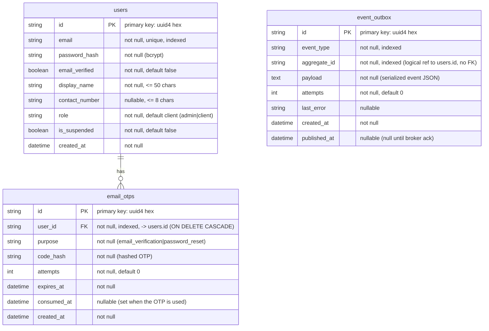

# user-service Data Model

Data model of **user-service** only. For how this service fits among the
others, see the repo-root [`docs/architecture.md`](../../docs/architecture.md);
for the API contract see [`api-contract.md`](./api-contract.md).

## Data model

### Title: user-db entity-relationship diagram

Every column below is taken directly from the ORM models in `app/models/`.
`user-db` holds three tables; the service owns this database and never reads
another service's data (DB-per-service).

### Legend

| Notation | Meaning |
| --- | --- |
| `PK` | Primary key. |
| `FK` | Foreign key. |
| `indexed` | Column has a database index (`index=True` on the `mapped_column`). |
| `users \|\|--o{ email_otps` | One user has zero or more OTP codes. |

### Explained elements

- **OTP lifecycle.** `email_otps` serves both email verification and password
  reset, distinguished by `purpose`. A code is hashed at rest (`code_hash`),
  rate-limited via `attempts`, expired by `expires_at`, and single-use via
  `consumed_at`. Rows cascade-delete with their user.
- **Transactional outbox.** `event_outbox` decouples the registration write
  from RabbitMQ publication. `UserRegistered` is written to the outbox in the
  same transaction as the user row; a background worker publishes unpublished
  rows (`published_at IS NULL`) and records `attempts` / `last_error` on retry.
  `aggregate_id` holds the user id as a value, not a database foreign key.
- **No cross-database foreign keys.** The credit balance lives in
  `credit-service`; it is referenced by user id over events/HTTP, never by a
  cross-DB FK, keeping services independently deployable.
