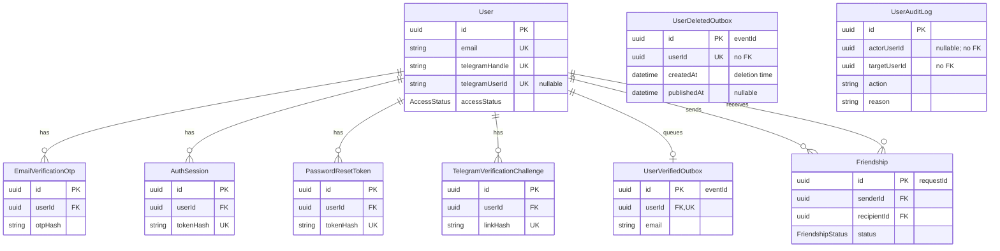

<!--
AI Assistance Disclosure
Tool: OpenAI Codex (GPT-5.6 Luna, GPT-5.6 Sol, GPT-6 Sol and GPT-6.1 Sol), 2026-09-25 to 2026-11-11.
Scope: Documentation wording assistance under author-finalized User Service requirements and architecture.
Author review: Josh Wang Kai Kiat validated correctness, edited where needed, and verified behavior/tests.
-->
# User Service database schema

[schema.prisma](../prisma/schema.prisma) is authoritative for stored fields, types, defaults, relations and ordinary indexes; [migration SQL](../prisma/migrations) also defines custom database constraints. This guide explains the nine models for debugging. See [architecture](architecture.md) for flows, the [README](../README.md) for commands and [API_CONTRACT_UPDATES.txt](../API_CONTRACT_UPDATES.txt) for wire formats.

## Table relationships

All nine models belong to User's PostgreSQL database. Admin owns report/appeal records and review decisions in its own database, so they are absent here. Appeal rate limits are process memory, not a table.

The diagram shows selected fields. Every model has a UUID primary key `id` and a `createdAt` timestamp defaulting to creation time. Cleanup explicitly supplies deletion-event `createdAt`. Prisma relation properties such as `User.sessions` are navigation helpers, not stored copies of child rows. Below, `?` means nullable; other fields are required.

## Stored fields by model

| Model | Fields beyond common `id` / `createdAt` | Debugging notes |
| --- | --- | --- |
| `User` | Identity: `email`, `name`, `passwordHash`, `telegramHandle`, `telegramUserId?`. Verification: `emailVerifiedAt?`, `telegramVerifiedAt?`. Access: `role`, `accessStatus`, `failedLoginAttempts`, `lockedAt?`, `authVersion`. Lifecycle: `lastLoginAt?`, `deletionRequestedAt?`, `scheduledDeletionAt?`, `suspendedAt?`, `suspensionReason?`, `updatedAt`. | Email, handle and linked Telegram ID are unique. Defaults: `USER`, `ACTIVE`, zero attempts/version. `updatedAt` is Prisma-maintained. |
| `Friendship` | `senderId`, `recipientId`, `status`, `updatedAt`. | Both IDs are cascading User FKs. Status defaults to `PENDING`; accepted relationships are mutual despite retaining sender/recipient. `id` is the API request ID. |
| `EmailVerificationOtp` | `userId`, `otpHash`, `expiresAt`, `attemptCount`, `usedAt?`, `revokedAt?`. | Cascading User FK; attempts default to zero. OTP HMAC-SHA-256 binds the code to normalized email and the server secret. |
| `AuthSession` | `userId`, `tokenHash`, `expiresAt`, `revokedAt?`, `lastUsedAt?`. | Cascading User FK; unique SHA-256 token hash. Multiple sessions per user are allowed. |
| `PasswordResetToken` | `userId`, `tokenHash`, `expiresAt`, `usedAt?`, `revokedAt?`. | Cascading User FK; unique SHA-256 reset-link token hash. Reset consumes the token, clears lockout and revokes sessions. |
| `TelegramVerificationChallenge` | `userId`, `linkHash`, `otpHash?`, `telegramUserId?`, `expiresAt`, `sentAt?`, `attemptCount`, `usedAt?`, `revokedAt?`. | Cascading User FK; unique deep-link hash, attempts default zero. Sender ID here is historical, not unique; linked identity uniqueness is on `User`. |
| `UserVerifiedOutbox` | `userId`, `email`, `publishedAt?`. | Unique cascading User FK: at most one row per account. Email is an event snapshot containing personal data. |
| `UserDeletedOutbox` | `userId`, `publishedAt?`. | Unique deleted-user UUID, deliberately **no FK**. Contains no profile fields and survives account removal. |
| `UserAuditLog` | `actorUserId?`, `targetUserId`, `action`, `reason`. | UUID references have **no FKs**. Survives removal; bootstrap's actor is null. Keep secrets/personal data out of free-text reasons. |

### Account and credential interpretation

Email and Telegram handle normalization, NUS-domain signup validation and trimmed name length (2–100 characters) are application rules. They are not database domain/length constraints. `passwordHash` is encoded salted scrypt, including cost parameters, salt and derived hash; it is not recoverable encryption. Telegram IDs are stored as text, distinct from handles.

Raw bearer/reset/deep-link tokens and OTPs are not stored. A credential row alone proves neither validity nor access: handlers check expiry, consumption/revocation, attempts and account restrictions. Pressing Telegram Start only prepares the challenge; authenticated OTP submission completes verification. Expired/used/revoked rows can remain; expiry is not automatic physical deletion.

`authVersion` increments on credential/administrative changes, alongside explicit session revocation; it is not a JWT claim or the sole revocation mechanism. Password reset clears login lockout. Reinstatement clears suspension, not missing verification or lockout.

## Computed public status

[status.ts](../src/status.ts) derives the public label; no `Created`/`Verified` column exists.

| Stored state | Public label |
| --- | --- |
| `accessStatus = SUSPENDED` | `Suspended`, regardless of verification timestamps |
| `ACTIVE` with both verification timestamps | `Verified` |
| `ACTIVE` with either timestamp missing | `Created` |

`role` (`USER`/`ADMIN`), `lockedAt`, pending deletion and session validity are separate from that label. Active `Created` accounts may use friendships without an Order-history check, provided they have a valid session and neither deletion requested nor scheduled.

Correct-password suspended login before the deletion deadline returns `403 ACCOUNT_SUSPENDED` even with `lockedAt`, creates no session and leaves the lock intact. A valid latest rejected appeal from Admin can enrich the message; failed/missing/invalid lookup falls back to generic suspension. Active locked login and locked appeal submission remain generic `401`. This behavior adds no stored state; details are in [architecture](architecture.md#reports-appeals-and-suspended-login).

## Friendship constraints and history

The [friendship migration](../prisma/migrations/20261027000000_friendships/migration.sql) supplements Prisma 5 with:

- `Friendship_not_self`: CHECK that `senderId <> recipientId`.
- `Friendship_active_pair_key`: unique `(LEAST(senderId, recipientId), GREATEST(senderId, recipientId))` only for `PENDING`/`ACCEPTED` rows. This prevents simultaneous active relations in either direction, including concurrent/crossed requests.

Application rules allow recipient-only `PENDING → ACCEPTED/REJECTED` and `ACCEPTED → REMOVED`; the enum alone does not enforce actors/transitions. Rejected/removed history permits a new invitation with a fresh UUID. Same-action accept/reject retries are idempotent while the result remains current; removal does not cancel pending invitations.

Suspended/deleting peers are excluded from lists and new invitations. Acceptance requires an available sender, including retries; rejection/removal may still act on an unavailable peer. These checks do not rewrite history. Mutations lock accounts in UUID order and recheck the caller/session. Physical deletion of either participant cascades the friendship row.

## Deletion and outbox guarantees

Scheduling deletion revokes sessions and temporary credentials and sets a deadline six calendar months later, clamped to the target month's last valid day. An eligible successful login before that deadline cancels deletion with a new session; old revoked sessions stay revoked. Neither scheduling nor restoration emits `UserDeleted`.

Final cleanup inserts the deletion outbox, records the audit and deletes `User` in **one transaction**. Failure rolls back all three. All six FK-linked child models cascade: email OTPs, sessions, reset tokens, Telegram challenges, verification outbox and friendships. `UserDeletedOutbox` and audit records survive independently. Cleanup also protects the last available administrator.

Both outboxes use `id` as stable `eventId`, `createdAt` as stable `occurredAt`, and nullable `publishedAt` as the acknowledgement marker. Verification completion and its outbox insertion commit together. Deletion occurrence time is cleanup's supplied `now`, not request/deadline/retry time. Deletion events carry only the user UUID; wire envelopes are in the [contract notes](../API_CONTRACT_UPDATES.txt).

Configured dispatchers retry pending rows every five seconds on `foc.user.status` (configurable), keyed by user UUID. Kafka failure leaves rows pending. A successful send followed by marker failure/crash can duplicate delivery: consumers deduplicate by `eventId`. Publication is asynchronous and does not prove downstream completion.

The verification FK still cascades; it cannot retract a verification send already in flight across replicas. Credit's checked-in consumer handles only `UserVerified`; future deletion handling needs a user-UUID tombstone to ignore late verification and agreed balance/history retention. Order already consumes `UserDeleted` to clean delivery-point associations. Neither outbox is an email queue.

## Indexes and retention

Besides primary/unique constraints and the custom friendship index, ordinary indexes cover:

| Model | Indexed fields |
| --- | --- |
| `User` | `accessStatus`; `scheduledDeletionAt` |
| `Friendship` | `(senderId, status, createdAt, id)`; `(recipientId, status, createdAt, id)` |
| `EmailVerificationOtp`, `TelegramVerificationChallenge` | `(userId, createdAt)`; `expiresAt` |
| `AuthSession`, `PasswordResetToken` | `userId`; `expiresAt` |
| Both outboxes | `(publishedAt, createdAt)` |
| `UserAuditLog` | `(targetUserId, createdAt)` |

Indexes speed lookups; they do not enforce expiry or permissions. There is no general retention sweep for expired credentials described here. Audit/outbox retention and Admin-owned report/appeal retention require separate policies.

## Changing the schema

Use versioned migrations for existing databases; `prisma db push` alone cannot reproduce the custom friendship CHECK/index. Required migrations include [20261027000000_friendships](../prisma/migrations/20261027000000_friendships/migration.sql) and [20261102000000_user_deleted_outbox](../prisma/migrations/20261102000000_user_deleted_outbox/migration.sql).

For structural changes, update the executable schema, generate/review migration SQL, apply migrations to the intended database, regenerate Prisma Client and check affected flows. Documentation edits or image rebuilds do not migrate data. Commands and validation procedures are maintained in the [README](../README.md).
